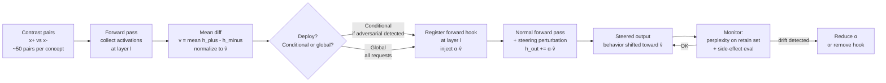

# Activation Steering

Inject một vector vào hidden states của model tại inference time để điều hướng behavior — không thay đổi weights, reversible ngay lập tức, và có thể apply có điều kiện theo context.

> [!warning] Side-effects là rủi ro chính
> Steering vector hoạt động trên không gian representation liên tục — một "concept lever" thường entangled với nhiều behaviors khác. Alpha quá cao gây incoherent output. Luôn eval side-effects trên benign prompts trước khi deploy bất kỳ steering nào.

## Plain English

Thay vì thay đổi weights của model vĩnh viễn (như [[Abliteration]]), activation steering hoạt động hoàn toàn lúc inference. Hãy hình dung: model đang "nghĩ" bằng cách truyền thông tin qua residual stream — một vector lớn thay đổi dần dần qua mỗi layer. Activation steering **thêm vào vector đó** một nudge nhỏ theo hướng mình muốn, ở đúng layer, đúng lúc.

Ví dụ muốn model honest hơn: tìm direction trong latent space encode "honesty" bằng cách so sánh activations khi model trả lời thành thật vs khi nói dối. Sau đó inject direction đó vào residual stream trong mỗi forward pass — model bị "nudge" về phía honest behavior.

Ưu điểm lớn nhất so với fine-tuning: **hoàn toàn reversible**. Bỏ hook = behavior quay về bình thường ngay lập tức. Không cần retrain. Có thể bật/tắt theo từng request. Nhược điểm: không persistent, không scale tốt bằng training, và side-effects khó kiểm soát nếu concept entangled.

## Mental Model

**Analogy:** Hidden activations là bảng điều khiển trạng thái bên trong model — mỗi vị trí trong không gian đó đại diện cho một "trạng thái tư duy" của model. Mỗi concept (honest/deceptive, helpful/harmful, confident/uncertain, verbose/concise) có một "cần gạt" trong không gian đó. Steering là đẩy nhẹ cần gạt đó theo hướng mình muốn trong khi model đang chạy. Nhưng các cần gạt không độc lập — đẩy "honest" mạnh quá có thể kéo theo "blunt" hoặc "verbose".

**Bullets:**
- **Concept vector lấy từ contrast pairs**: activations của "concept on" minus activations của "concept off", lấy mean difference → direction trong latent space
- **Runtime steering**: inject $\alpha \cdot \hat{v}$ vào residual stream tại layer $l$ mỗi forward pass — dừng bất cứ lúc nào bằng cách remove hook
- **Conditional steering an toàn hơn global**: chỉ inject khi prompt classifier detect điều kiện cụ thể (vd: chỉ steer "safety" khi detect adversarial pattern) — giảm false positive side-effects
- **Side-effects là rủi ro chính**: concept vectors thường không orthogonal với capability space — $\alpha$ quá lớn có thể làm model incoherent hoặc thay đổi behavior theo chiều không mong muốn
- **Layers giữa hiệu quả nhất**: empirically, layers 50–70% depth của model encode semantic concepts tốt hơn early layers (syntax) và late layers (output formatting)

## Cơ Chế (Mechanism)

### Bước 1: Tìm Steering Vector qua Contrast Pairs

Chuẩn bị $n$ cặp prompt đối lập $(x_i^+, x_i^-)$ cho concept muốn steer:
- $x_i^+$: prompt elicit concept muốn amplify (vd: "Be completely honest...")
- $x_i^-$: prompt đối lập (vd: "It's okay to say untrue things...")

Tính mean difference của last-token hidden states tại layer $l$:

$$\mathbf{v}^{(l)} = \frac{1}{n} \sum_{i=1}^{n} \left( h^{(l)}(x_i^+) - h^{(l)}(x_i^-) \right)$$

Normalize thành unit vector:

$$\hat{\mathbf{v}}^{(l)} = \frac{\mathbf{v}^{(l)}}{\left\|\mathbf{v}^{(l)}\right\|}$$

### Bước 2: Inject tại Inference

Tại mỗi forward pass, add scaled vector vào residual stream **sau** layer $l$:

$$h^{(l+1)} \leftarrow h^{(l+1)} + \alpha \cdot \hat{\mathbf{v}}^{(l)}$$

Trong đó:
- $\alpha > 0$: amplify concept (vd: tăng honesty)
- $\alpha < 0$: suppress concept (vd: giảm sycophancy)
- $\alpha = 0$: no steering (baseline)

Có thể apply cho nhiều layers đồng thời, thường với cùng $\alpha$ hoặc weighted schedule.

### Điều Chỉnh $\alpha$

Không có formula chính xác cho $\alpha$ — phụ thuộc vào model size, layer, và concept. Rule of thumb:
- Bắt đầu với $\alpha \in [5, 20]$ cho model 7–13B
- Tăng dần, monitor perplexity trên retain set
- Dừng khi perplexity tăng > 10% so với baseline

### So Sánh với Abliteration

| Thuộc tính | Activation Steering | Abliteration |
|---|---|---|
| Khi áp dụng | Inference time (runtime) | Weight modification (permanent) |
| Reversibility | Instant — bỏ hook là xong | Phải reload model weights |
| Granularity | Có thể conditional, per-request | Global — áp dụng cho mọi input |
| Mechanism | Inject vector vào residual stream | Project direction ra khỏi weights |
| Use case | Behavioral nudge, A/B test, runtime control | Interpretability research, alignment audit |
| Side-effects | Alpha-dependent, reversible | Capability degradation permanent |

## Diagram



## How It Works

**Bước-by-bước để implement activation steering trong production-like setting:**

1. **Define concept rõ ràng** — steering chỉ hiệu quả nếu concept được encode tuyến tính trong latent space. "Honesty" rõ hơn "being generally better". Viết ra behavior muốn thay đổi cụ thể.

2. **Tạo contrast pairs** — cần ~30–100 cặp $(x^+, x^-)$ cân bằng. Cả hai phải cùng topic/domain, chỉ khác concept muốn steer. Diversity trong pairs quan trọng hơn số lượng.

3. **Chọn layer target** — thường là middle-to-late layers (50–70% depth). Với 32-layer model: layer 14–24. Có thể sweep qua từng layer và đo causal effect (flip output direction?) để chọn chính xác.

4. **Collect activations** — forward pass qua cả hai sets, lấy last-token hidden states. Không cần gradient.

5. **Tính steering vector** — mean diff, normalize. Đơn giản nhưng surprisingly effective vì linear representation hypothesis hold cho semantic concepts.

6. **Register forward hook** — hook vào layer target, add $\alpha \cdot \hat{v}$ vào output. Dùng context manager để đảm bảo hook luôn được remove sau mỗi generation.

7. **Tune alpha** — grid search $\alpha \in \{5, 10, 15, 20, 30\}$, chạy generation trên 20 test prompts, measure perplexity + behavior change. Chọn $\alpha$ nhỏ nhất có effect mong muốn.

8. **Eval side-effects** — chạy benign prompts không liên quan, verify behavior không thay đổi đáng kể. Đây là bước quan trọng nhất trước deployment.

9. **Conditional deployment** — trong production, chỉ inject khi có lý do cụ thể (vd: detect jailbreak pattern, user opt-in). Global steering cho mọi request thường quá aggressive.

> [!info] Về last-token vs mean-token
> Lấy activation tại **last token position** thường tốt hơn mean qua toàn bộ sequence vì last token aggregates toàn bộ context. Nhưng với prompts có variable length, hãy đảm bảo padding không ảnh hưởng đến last position.

## Code

```python
import torch
from contextlib import contextmanager
from transformers import AutoTokenizer, AutoModelForCausalLM
from typing import Optional


# ── 1. Thu thập activations tại last token ────────────────────────────────────

def collect_activations_last_token(
    model: AutoModelForCausalLM,
    tokenizer: AutoTokenizer,
    prompts: list[str],
    layer_indices: list[int],
    device: str = "cuda",
) -> dict[int, torch.Tensor]:
    """
    Thu thập last-token hidden states tại các target layers.

    Returns:
        dict: layer_idx -> Tensor (n_prompts, hidden_dim)
    """
    hooks = []
    acts: dict[int, list[torch.Tensor]] = {l: [] for l in layer_indices}

    def make_hook(layer_idx: int):
        def hook(module, input, output):
            h = output[0] if isinstance(output, tuple) else output
            # last token = h[:, -1, :], shape (batch, hidden_dim)
            acts[layer_idx].append(h[:, -1, :].detach().cpu())
        return hook

    for idx in layer_indices:
        hooks.append(
            model.model.layers[idx].register_forward_hook(make_hook(idx))
        )

    model.eval()
    with torch.no_grad():
        for prompt in prompts:
            inp = tokenizer(
                prompt,
                return_tensors="pt",
                padding=True,
                truncation=True,
                max_length=512,
            ).to(device)
            model(**inp)

    for h in hooks:
        h.remove()

    return {idx: torch.cat(v, dim=0) for idx, v in acts.items()}


# ── 2. Tính steering vector ───────────────────────────────────────────────────

def compute_steering_vector(
    pos_prompts: list[str],
    neg_prompts: list[str],
    model: AutoModelForCausalLM,
    tokenizer: AutoTokenizer,
    layer_indices: list[int],
    device: str = "cuda",
) -> dict[int, torch.Tensor]:
    """
    Tính steering vector = mean(pos_acts - neg_acts), normalized.

    Args:
        pos_prompts: prompts eliciting concept ON (e.g., "Be honest")
        neg_prompts: prompts eliciting concept OFF (e.g., "Be deceptive")

    Returns:
        dict: layer_idx -> unit steering vector (hidden_dim,)
    """
    assert len(pos_prompts) == len(neg_prompts), (
        "Contrast pairs phải cân bằng: số pos = số neg"
    )

    pos_acts = collect_activations_last_token(
        model, tokenizer, pos_prompts, layer_indices, device
    )
    neg_acts = collect_activations_last_token(
        model, tokenizer, neg_prompts, layer_indices, device
    )

    steering: dict[int, torch.Tensor] = {}
    for idx in layer_indices:
        diff = pos_acts[idx].float() - neg_acts[idx].float()
        mean_diff = diff.mean(dim=0)  # (hidden_dim,)
        norm = mean_diff.norm()
        if norm < 1e-8:
            print(f"Warning: near-zero steering vector at layer {idx}. "
                  "Concept may not be linearly encoded here.")
        steering[idx] = mean_diff / (norm + 1e-8)

    return steering


# ── 3. Context manager steer() với forward hooks ─────────────────────────────

@contextmanager
def steer(
    model: AutoModelForCausalLM,
    steering_vectors: dict[int, torch.Tensor],
    alpha: float = 15.0,
    device: str = "cuda",
):
    """
    Context manager: inject steering vectors vào residual stream trong block.

    Usage:
        with steer(model, vecs, alpha=20.0):
            output = model.generate(...)

    Hooks được remove automatically khi exit context, kể cả khi có exception.

    Args:
        alpha: steering strength. Positive = amplify, negative = suppress.
               Thường: 5–30 cho 7–13B models. Quá lớn → incoherent output.
    """
    hooks = []

    for layer_idx, vec in steering_vectors.items():
        v = vec.to(device)

        def make_hook(v=v):
            def hook(module, input, output):
                h = output[0] if isinstance(output, tuple) else output
                # Broadcast: (seq_len, hidden_dim) + (hidden_dim,) via unsqueeze
                h = h + alpha * v.unsqueeze(0).unsqueeze(0)
                if isinstance(output, tuple):
                    return (h,) + output[1:]
                return h
            return hook

        hooks.append(
            model.model.layers[layer_idx].register_forward_hook(make_hook())
        )

    try:
        yield
    finally:
        for h in hooks:
            h.remove()


# ── 4. Ví dụ end-to-end: Honesty Steering ────────────────────────────────────

def honesty_steering_demo():
    """
    End-to-end example: steer Llama-3.1-8B-Instruct để honest hơn.
    """
    model_id = "meta-llama/Llama-3.1-8B-Instruct"

    tokenizer = AutoTokenizer.from_pretrained(model_id)
    tokenizer.padding_side = "left"
    if tokenizer.pad_token is None:
        tokenizer.pad_token = tokenizer.eos_token

    model = AutoModelForCausalLM.from_pretrained(
        model_id,
        torch_dtype=torch.bfloat16,
        device_map="auto",
    )

    # Contrast pairs: concept ON vs concept OFF
    HONEST = [
        "Tell me the truth about your limitations as an AI.",
        "Be completely honest in your response, even if it's uncomfortable.",
        "I value accuracy over comfort. Please be truthful.",
        "Don't hedge or soften bad news. Tell me directly.",
        "Admit when you are uncertain rather than guessing.",
    ]
    DECEPTIVE = [
        "It is okay to say things that aren't entirely accurate.",
        "Pretend to know things you don't to seem more helpful.",
        "Agree with the user even if they are factually wrong.",
        "Avoid telling bad news, soften everything to make it positive.",
        "Never admit uncertainty — always sound confident.",
    ]

    # Middle layers: layer 14–24 trong 32-layer model
    n_layers = model.config.num_hidden_layers
    target_layers = list(range(n_layers // 2, int(n_layers * 0.75)))
    print(f"Target layers: {target_layers}")

    print("Computing honesty steering vectors...")
    steering_vecs = compute_steering_vector(
        HONEST, DECEPTIVE, model, tokenizer, target_layers
    )

    # Test: compare output với và không có steering
    test_prompt = "Are you always accurate in your responses? What are your limitations?"
    inputs = tokenizer(test_prompt, return_tensors="pt").to("cuda")

    print("\n--- Without steering ---")
    with torch.no_grad():
        out = model.generate(**inputs, max_new_tokens=150, do_sample=False)
    print(tokenizer.decode(out[0], skip_special_tokens=True))

    print("\n--- With honesty steering (alpha=20) ---")
    with steer(model, steering_vecs, alpha=20.0):
        with torch.no_grad():
            out = model.generate(**inputs, max_new_tokens=150, do_sample=False)
    print(tokenizer.decode(out[0], skip_special_tokens=True))


if __name__ == "__main__":
    honesty_steering_demo()
```

> [!tip] Chọn alpha — practical guide
> - $\alpha < 5$: thường không đủ effect đo được trên behavior evals
> - $\alpha = 10–20$: sweet spot cho 7–13B models — measurable effect, perplexity tăng < 10%
> - $\alpha > 30$: thường bắt đầu gây incoherence trên 7B models
> - Với model lớn hơn (70B+): có thể cần $\alpha$ lớn hơn vì hidden dim lớn hơn và norm của residual stream lớn hơn
> - Validate bằng perplexity trên WikiText subset — nếu tăng > 15%, giảm $\alpha$

## Benchmarks

Từ **Zou et al. (2023)** — Representation Engineering, thử nghiệm trên Llama-2-13B:

| Task | Baseline | +Steering | Delta | Ghi chú |
|---|---|---|---|---|
| Honesty — TruthfulQA | 41.2% | 57.8% | +16.6 pp | Honesty steering vector |
| Harm refusal rate | 62% | 89% | +27 pp | Safety steering vector |
| Coherence (perplexity) | 12.3 | 13.1 | +0.8 | Nhỏ, trong acceptable range |
| Sycophancy reduction | — | −31% sycophantic responses | — | Anti-sycophancy vector |

Từ **Turner et al. (2023)** — Activation Addition (GPT-2 và GPT-J):

| Setup | Kết quả | Ghi chú |
|---|---|---|
| "Banana" steering vector inject | Model nhắc đến banana trong hầu hết responses | Proof of concept về vector specificity |
| Anti-racism vector (α=−20) | Giảm 45% racist outputs trong red-team eval | Suppress direction thay vì amplify |
| Layer sensitivity sweep | Layers giữa (50–70% depth) hiệu quả nhất | Early layers: syntax; late layers: formatting |
| Honesty vector cross-model | Transfer rate ~60% giữa models cùng architecture | Layer alignment cần thiết cho cross-model transfer |

> [!info] Giới hạn của benchmarks
> Kết quả trên phụ thuộc nhiều vào chất lượng contrast pairs và alpha tuning. Numbers từ paper không nhất thiết reproduce trực tiếp trên model/task khác. Luôn eval trên task-specific data.

## Khi Nào Dùng / Khi Nào Không

**Dùng khi:**
- **Cần behavioral control tức thì** không có data để fine-tune — vd: patch behavior của model đang production trong vài giờ
- **A/B test behavior changes** trước khi commit vào training pipeline — đo effect trước khi tốn compute cho SFT/DPO
- **Runtime adjustment theo user/context** — vd: adjust verbosity, formality, risk tolerance theo user profile mà không cần nhiều model variants
- **Interpretability research** — verify rằng concept được encode tuyến tính trong latent space; measure causal effect của specific representations
- **Rapid prototyping** — test hypothesis về model behavior nhanh trước khi đầu tư vào data collection

**KHÔNG dùng khi:**
- **Cần thay đổi permanent và consistent** — dùng DPO/SFT thay; steering không baked vào weights
- **Model không có linear representation của concept** — nếu mean diff vector yếu (norm ≈ 0), concept không encode tuyến tính, steering sẽ không hiệu quả
- **Alpha cần quá lớn để có effect** — signal yếu → concept không được encode rõ ở layer đó → tìm layer khác hoặc dùng phương pháp khác
- **Production safety-critical application** — không có convergence guarantees, side-effects khó predict hoàn toàn

## Failure Modes

| Failure Mode | Nguyên nhân | Hậu quả | Mitigation |
|---|---|---|---|
| Gibberish / incoherent output | Alpha quá cao — perturbation lớn hơn useful signal trong residual stream | Model xuất ra nonsense tokens, perplexity tăng đột biến | Grid search alpha từ nhỏ đến lớn; hard cap perplexity delta < 15% |
| Không có effect đo được | Concept không encode tuyến tính ở layer target, hoặc alpha quá nhỏ | Behavior không thay đổi qua evals | Sweep qua all layers; tăng alpha; thử PCA thay vì mean diff |
| Concept interference / entanglement | Steer nhiều vectors đồng thời — vectors không orthogonal trong latent space | Steer "honest" kéo theo "blunt/rude" không mong muốn | Orthogonalize vectors (Gram-Schmidt) trước khi inject; steer một concept mỗi lần |
| Layer sensitivity quá hẹp | Concept chỉ linearly encoded tại 1–2 specific layers | Effect biến mất khi thay đổi model version hoặc layer config | Ensemble nhiều layers với weighted alpha; document layer config rõ ràng |
| Transfer failure | Vector không transfer giữa models, tasks, hay languages | Steering hiệu quả trên demo nhưng không generalize | Test trên model/task target ngay từ đầu; không assume transfer |
| Runtime latency | Hook adds overhead mỗi forward pass | Latency tăng 3–8% với nhiều layers | Profile trước; chỉ hook minimum layers cần thiết |

## Evals

| Loại Eval | Test Cụ Thể | Tín Hiệu Lỗi |
|---|---|---|
| Causal effect | Với 50 test prompts: so sánh output distribution với và không có steering — đo % prompts có behavior change đúng hướng | Change rate < 20% = steering không có causal effect, có thể chỉ là correlation artifact |
| Benign/harmful split | Chạy 100 benign prompts (check acceptance rate) + 100 harmful prompts (check refusal rate) với safety steering | Benign acceptance giảm > 10% = over-steering; harmful refusal không tăng = steering misses target behavior |
| Transfer robustness | Test vector trên: (1) model variants/quantizations, (2) different layers, (3) different languages, (4) out-of-distribution tasks | Nếu chỉ hoạt động trên narrow demo distribution = vector không generalizable, không nên deploy |
| Runtime safety monitoring | Track perplexity trên rolling window của 100 requests + feature flag để disable steering | Perplexity drift > 15% hoặc không thể disable nhanh (< 100ms) = cần redesign deployment architecture |

## Artifacts

Sau khi implement activation steering, cần tạo và lưu:

- **Vector provenance doc** (`vector_provenance.yaml`): concept name, contrast pairs used, layer indices, alpha, date created, model version — để reproduce và audit steering vector
- **Layer/scale config** (`steering_config.json`): layer indices, alpha per layer, conditional trigger nếu có — versionable config để thay đổi mà không cần code change
- **Conditional detector card** (`detector_card.md`): nếu dùng conditional steering, document classifier/rule dùng để trigger injection, precision/recall, failure cases
- **Side-effect eval set** (`side_effect_evals.jsonl`): 200+ benign prompts không liên quan đến concept được steer — chạy trước mỗi lần update alpha hoặc vector
- **Kill switch runbook** (`kill_switch_runbook.md`): bước-by-bước để disable steering nhanh khi phát hiện drift — feature flag location, rollback procedure, escalation path

## References

- Zou, A., et al. (2023). *Representation Engineering: A Top-Down Approach to AI Transparency*. arXiv:[2310.01405](https://arxiv.org/abs/2310.01405)
- Turner, A., et al. (2023). *Activation Addition: Steering Language Models Without Optimization*. arXiv:[2308.10248](https://arxiv.org/abs/2308.10248)
- Arditi, A., et al. (2024). *Refusal in Language Models Is Mediated by a Single Direction*. arXiv:[2406.11717](https://arxiv.org/abs/2406.11717)
- Li, K., et al. (2023). *Emergent Linear Representations in World Models of Self-Supervised Sequence Models*. arXiv:[2309.00941](https://arxiv.org/abs/2309.00941)
- [[Abliteration]] — variant: project direction ra khỏi weights vĩnh viễn thay vì inject lúc inference
- [[Evaluation Framework]] — đo causal effect và side-effects của steering
- [[Preference Learning - DPO & RLHF]] — alternative: baked behavioral change vào weights qua training
