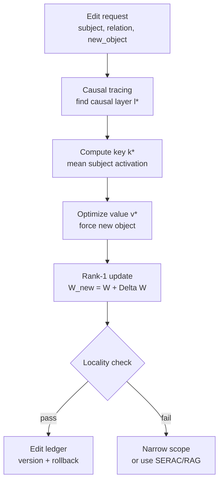

---
tags:
  - llm
  - model-editing
  - knowledge-editing
  - rome
  - memit
aliases:
  - ROME
  - MEMIT
  - Knowledge Editing
description: 'Knowledge editing giống như sửa một thẻ trong từ điển bên trong model. Nếu model tin rằng "Eiffel Tower nằm ở Rome", ta muốn sửa thành "Eiffel Tower nằm ở Paris" mà không cần fine-tune lại toàn bộ model.'
---

# Knowledge Editing — ROME & MEMIT

> Sửa một fact cụ thể trực tiếp trong weights của LLM, với mục tiêu đổi target fact mà vẫn giữ locality, generality và capability lân cận.

## Plain English

Knowledge editing giống như sửa một thẻ trong từ điển bên trong model. Nếu model tin rằng "Eiffel Tower nằm ở Rome", ta muốn sửa thành "Eiffel Tower nằm ở Paris" mà không cần fine-tune lại toàn bộ model.

Điểm khó không phải chỉ là làm model trả lời đúng một câu hỏi target. Điểm khó là sửa đúng nhưng không làm hỏng các facts gần đó: Eiffel Tower cao bao nhiêu, Paris là thủ đô nước nào, Rome thuộc quốc gia nào, hoặc các câu hỏi paraphrase cùng nghĩa.

ROME tập trung vào một edit hẹp: sửa một fact tại một vị trí causal trong MLP weights. MEMIT mở rộng ý tưởng đó cho batch lớn, có thể edit hàng nghìn facts bằng cách phân phối update qua nhiều layers.

## Mental Model

Analogy: Model là một thư viện tri thức khổng lồ. Một fact giống như một thẻ mục lục có liên kết đến nhiều thẻ khác. ROME là sửa thủ công một thẻ quan trọng; MEMIT là batch update nhiều thẻ cùng lúc với kiểm soát để thư viện không bị xáo trộn.

- **Efficacy**: prompt target sau edit phải trả lời object mới.
- **Generality**: paraphrase, template khác, hoặc cách hỏi khác vẫn phải trả lời object mới.
- **Locality**: facts liên quan nhưng không nằm trong scope không được đổi sai.
- **Portability**: edit vẫn hoạt động trong context dài, multi-turn, ngôn ngữ khác, hoặc có retrieval.
- **Rollback**: mọi edit cần ledger và checkpoint để reverse nếu locality fail.

## Cơ chế (Mechanism)

ROME bắt đầu bằng causal tracing: chạy clean prompt, chạy corrupted prompt bằng cách làm nhiễu subject representation, rồi restore activation từng layer để tìm layer nào khôi phục xác suất output đúng.

Với fact dạng:

$$
(s, r, o) \rightarrow (s, r, o^*)
$$

trong đó \(s\) là subject, \(r\) là relation, \(o\) là object cũ, \(o^*\) là object mới.

ROME giả định factual association được ghi chủ yếu trong MLP tại một causal layer \(l^*\). Ta cần tìm key \(k^*\) đại diện subject và value \(v^*\) mới cần ghi vào MLP.

Key thường là mean activation của subject tại causal layer:

$$
k^* = \mathbb{E}_{x \sim \mathcal{P}(s)}[h_{l^*}(x)]
$$

Value \(v^*\) được optimize để model tăng xác suất object mới:

$$
v^* = \arg\min_v -\log P_{\theta(v)}(o^* \mid x)
       + \lambda \cdot D_{KL}(P_{\theta_0}(\cdot \mid x') \parallel P_{\theta(v)}(\cdot \mid x'))
$$

Sau đó apply rank-1 update vào MLP projection:

$$
W_{\text{new}} = W + \Delta W
$$

$$
\Delta W = \frac{(v^* - Wk^*)k^{*T}}{k^{*T}k^*}
$$

Điều kiện quan trọng:

$$
W_{\text{new}}k^* = v^*
$$

MEMIT tổng quát hóa sang nhiều edits và nhiều layers. Với set keys \(K^{(l)}\), residual targets \(R^{(l)}\), và covariance \(C^{(l)}\):

$$
\Delta W^{(l)} = R^{(l)}(C^{(l)} + K^{(l)}K^{(l)T})^{-1}K^{(l)T}
$$

ROME là precision surgery cho một fact; MEMIT là batched weight update có regularization để giảm interference.

## Diagram



## How It Works

1. Define edit spec: subject, relation, old object, new object, target prompts, paraphrase prompts, locality prompts.
2. Run baseline eval để biết model đang trả lời gì trước edit.
3. Chạy causal tracing: corrupt subject representation, restore từng activation, đo layer nào khôi phục output đúng.
4. Tính key \(k^*\): mean activation của subject tại causal layer trên nhiều prompt templates.
5. Optimize value \(v^*\): dùng gradient descent để tăng xác suất object mới, đồng thời giữ distribution trên retain prompts bằng KL penalty.
6. Apply rank-1 update vào MLP weight tại layer causal.
7. Verify efficacy: target prompt trả lời đúng object mới.
8. Verify generality: paraphrase, template khác, ngôn ngữ khác vẫn đúng.
9. Verify locality: same subject different relation, related subject, unrelated QA không bị đổi sai.
10. Ghi edit ledger: model hash, layer, weight name, old checksum, delta checksum, eval report, rollback path.

## Code

```python
import torch
from dataclasses import dataclass
from transformers import AutoModelForCausalLM, AutoTokenizer


@dataclass
class EditSpec:
    subject: str
    relation_prompt: str
    new_object: str
    target_prompts: list[str]
    locality_prompts: list[str]


def get_mlp_down_weight(model: AutoModelForCausalLM, layer_idx: int) -> torch.nn.Parameter:
    layer = model.model.layers[layer_idx]
    if hasattr(layer.mlp, "down_proj"):
        return layer.mlp.down_proj.weight
    if hasattr(layer.mlp, "c_proj"):
        return layer.mlp.c_proj.weight
    raise ValueError("Unsupported MLP module layout")


def collect_subject_key(
    model: AutoModelForCausalLM,
    tokenizer: AutoTokenizer,
    prompts: list[str],
    subject: str,
    layer_idx: int,
    device: str = "cuda",
) -> torch.Tensor:
    acts = []
    handle = None

    def hook(_, __, output):
        h = output[0] if isinstance(output, tuple) else output
        acts.append(h.detach())

    layer = model.model.layers[layer_idx]
    handle = layer.register_forward_hook(hook)

    model.eval()
    with torch.no_grad():
        for prompt in prompts:
            inputs = tokenizer(prompt, return_tensors="pt").to(device)
            model(**inputs)

    handle.remove()

    # Practical simplification: use last subject token position.
    subject_ids = tokenizer(subject, add_special_tokens=False).input_ids
    subject_len = max(1, len(subject_ids))
    keys = [a[:, -subject_len:, :].mean(dim=1).squeeze(0) for a in acts]
    return torch.stack(keys).mean(dim=0)


def optimize_value_vector(
    model: AutoModelForCausalLM,
    tokenizer: AutoTokenizer,
    edit: EditSpec,
    layer_idx: int,
    key: torch.Tensor,
    steps: int = 80,
    lr: float = 5e-2,
    kl_weight: float = 0.1,
    device: str = "cuda",
) -> torch.Tensor:
    value = torch.nn.Parameter(key.detach().clone())
    optimizer = torch.optim.Adam([value], lr=lr)
    target_id = tokenizer.encode(" " + edit.new_object, add_special_tokens=False)[0]
    layer = model.model.layers[layer_idx]

    def value_hook(_, __, output):
        h = output[0] if isinstance(output, tuple) else output
        h = h.clone()
        h[:, -1, :] = value
        return (h,) + output[1:] if isinstance(output, tuple) else h

    model.eval()
    for _ in range(steps):
        losses = []
        handle = layer.register_forward_hook(value_hook)
        for prompt in edit.target_prompts:
            inputs = tokenizer(prompt, return_tensors="pt").to(device)
            logits = model(**inputs).logits[:, -1, :]
            nll = torch.nn.functional.cross_entropy(
                logits,
                torch.tensor([target_id], device=device),
            )
            losses.append(nll)
        handle.remove()

        loss = torch.stack(losses).mean() + kl_weight * (value - key).pow(2).mean()
        optimizer.zero_grad()
        loss.backward()
        optimizer.step()

    return value.detach()


def apply_rome_rank_one_update(
    model: AutoModelForCausalLM,
    layer_idx: int,
    key: torch.Tensor,
    target_value: torch.Tensor,
) -> torch.Tensor:
    W = get_mlp_down_weight(model, layer_idx)
    key = key.to(W.device, W.dtype)
    target_value = target_value.to(W.device, W.dtype)

    with torch.no_grad():
        current_value = W @ key
        residual = target_value - current_value
        delta = residual[:, None] @ key[None, :] / (key @ key + 1e-8)
        W += delta
    return delta


def memit_style_closed_form_update(
    W: torch.Tensor,
    keys: torch.Tensor,
    residuals: torch.Tensor,
    covariance: torch.Tensor,
    ridge: float = 1e-4,
) -> torch.Tensor:
    # keys: [n_edits, d_in], residuals: [d_out, n_edits]
    K = keys.T
    C = covariance + ridge * torch.eye(covariance.shape[0], device=W.device)
    middle = torch.linalg.solve(C + K @ K.T, K)
    delta = residuals @ middle.T
    return W + delta
```

## Benchmarks

Các số dưới đây là benchmark representative từ ROME/MEMIT papers và thường được dùng để hiểu trade-off, không nên copy thành SLA production nếu dataset/model khác.

| Metric | ROME | MEMIT | Fine-tune |
|---|---:|---:|---:|
| Efficacy | 99.6% | 99.2% | 85.1% |
| Specificity / Locality | 97.1% | 96.8% | 72.3% |
| Generalization | 82.4% | 80.1% | 68.7% |
| Batch size | 1 | 10,000+ | unlimited |
| Time/edit | ~0.5s | ~0.1s amortized | hours |
| Typical target layer | MLP mid layers | multiple MLP layers | all trainable params |

Operational interpretation:

- ROME rất mạnh cho một fact hẹp, nhưng không phải tool để "update toàn bộ knowledge base".
- MEMIT tốt khi cần batch edit, nhưng interference tăng khi edit set có subjects/relations chồng lấn.
- Fine-tune có thể đạt target behavior nhưng locality kém hơn vì update lan rộng.

## Khi Nào Dùng / Khi Nào Không

| Dùng khi | Không dùng khi |
|---|---|
| Cần sửa một fact hẹp trong weights | Fact thay đổi thường xuyên và nên sống trong RAG/source data |
| Có target, paraphrase, locality eval rõ ràng | Không có locality set để đo collateral damage |
| Cần batch edit nhiều facts cùng schema | Edits mâu thuẫn logic hoặc cùng subject/relation |
| Có rollback checkpoint và edit ledger | Production pipeline không có cách reverse patch |
| Research cần chứng minh causal location | Chỉ cần behavior preference rộng như tone/safety |

## Failure Modes

| Failure | Nguyên nhân | Mitigation |
|---|---|---|
| Edit không có hiệu lực | Sai causal layer hoặc key không đại diện subject | Causal tracing kỹ hơn, nhiều prompt templates |
| Prompt-specific edit | Optimize quá hẹp trên một template | Paraphrase set trong objective và eval |
| Locality damage | Rank-1 update đụng facts gần subject/relation | Neighbor fact eval, KL retain, giảm update norm |
| Batch interference | MEMIT edit set có keys gần nhau hoặc object conflict | Cluster edits, split batch, kiểm per-edit score |
| Portability gap | Edit chỉ hoạt động trong context ngắn/ngôn ngữ chính | Multi-turn, long-context, multilingual eval |
| Rollback khó | Không lưu delta/checkpoint trước update | Edit ledger bắt buộc, store delta và model hash |

## Evals

| Loại eval | Test cụ thể | Tín hiệu lỗi |
|---|---|---|
| Efficacy | Target prompt trả lời đúng object mới | Edit không có hiệu lực |
| Generality | Paraphrase, template khác, ngôn ngữ khác | Chỉ đúng prompt train |
| Locality | Same entity khác attribute, related entity, unrelated QA | Phá facts lân cận |
| Portability | Context dài, multi-turn, retrieval/no retrieval | Không ổn định ngoài demo ngắn |
| Regression | MMLU/task-specific/coding sau edit | Capability giảm không liên quan |
| Rollback | Apply inverse delta hoặc restore checkpoint | Không quay lại được baseline |

## Artifacts

- Edit spec: subject, relation, old object, new object, scope, owner.
- Target prompt set và paraphrase set.
- Locality test set: neighbor facts, unrelated QA, same subject different relation.
- Causal tracing report: layer scores, chosen layer, confidence.
- Edit ledger: model hash, weight path, delta checksum, timestamp, eval link.
- Rollback checkpoint hoặc inverse delta.
- Post-edit eval report với pass/fail thresholds.

## References

- Meng et al. (2022). *Locating and Editing Factual Associations in GPT*. [arXiv:2202.05262](https://arxiv.org/abs/2202.05262)
- Meng et al. (2022). *Mass-Editing Memory in a Transformer*. [arXiv:2210.07229](https://arxiv.org/abs/2210.07229)
- Mitchell et al. (2022). *Memory-Based Model Editing at Scale*. [arXiv:2206.06520](https://arxiv.org/abs/2206.06520)
- Hase et al. (2023). *Does Localization Inform Editing?*. [arXiv:2301.04213](https://arxiv.org/abs/2301.04213)
- [[Evaluation Framework]]
- [[Machine Unlearning]]
- [[Task Vectors & Model Merging]]
