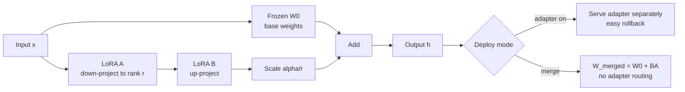

---
tags:
  - llm
  - model-editing
  - lora
  - peft
  - qlora
aliases:
  - LoRA
  - PEFT
  - QLoRA
description: 'LoRA không train lại toàn bộ model. Nó đóng băng base model và học một delta nhỏ hơn rất nhiều so với full fine-tune.'
---

# LoRA & PEFT

> Parameter-efficient fine-tuning bằng adapter rank thấp: train delta nhỏ, giữ base model frozen, dễ swap/rollback khi chưa merge.

## Plain English

LoRA không train lại toàn bộ model. Nó đóng băng base model và học một delta nhỏ hơn rất nhiều so với full fine-tune. Delta này được gắn vào một số projection layers như một adapter.

Nếu adapter chưa merge, bạn có thể bật/tắt hoặc đổi adapter theo task, tenant, domain, persona. Nếu merge adapter vào base weights, inference gọn hơn nhưng rollback khó hơn và cần verify lại safety.

QLoRA đi thêm một bước: base model được quantize 4-bit để giảm memory, trong khi LoRA adapter vẫn train ở precision cao hơn. Vì vậy bạn có thể fine-tune model rất lớn trên phần cứng ít hơn full fine-tune nhiều lần.

## Mental Model

Analogy: Base model là máy chính. Adapter là module gắn ngoài để đổi kỹ năng. Khi chưa merge, tháo module ra được; khi merge, module đã hàn vào máy chính, muốn rollback phải có checkpoint hoặc inverse delta.

- Base weights frozen trong lúc train.
- LoRA học delta rank thấp ở projection layers.
- QLoRA tiết kiệm memory bằng 4-bit NF4 quantization cho base model.
- Adapter có thể route theo tenant/domain/persona.
- Adapter không tự an toàn: nó có thể override refusal hoặc làm drift safety.
- Merge là deployment decision, không chỉ là optimization.

## Cơ chế (Mechanism)

Với một linear layer có weight \(W_0 \in \mathbb{R}^{d \times k}\), LoRA thay vì update toàn bộ \(W_0\), học:

$$
W_{\text{new}} = W_0 + \Delta W = W_0 + BA
$$

Trong đó:

$$
B \in \mathbb{R}^{d \times r}, \quad A \in \mathbb{R}^{r \times k}, \quad r \ll \min(d,k)
$$

Forward pass:

$$
h = W_0x + \frac{\alpha}{r}BAx
$$

Số trainable params giảm từ \(dk\) xuống:

$$
r(d+k)
$$

Initialization thường dùng:

$$
A \sim \mathcal{N}(0, \sigma^2), \quad B = 0
$$

Do đó:

$$
\Delta W = 0
$$

tại bước đầu, giúp adapter không phá behavior ban đầu trước khi train.

QLoRA giữ \(W_0\) ở 4-bit NF4 và train \(A, B\) ở fp16/bf16:

$$
h = \text{dequant}(W_0^{NF4})x + \frac{\alpha}{r}BAx
$$

Target modules phổ biến trong Llama-style models:

- attention: `q_proj`, `k_proj`, `v_proj`, `o_proj`
- MLP: `gate_proj`, `up_proj`, `down_proj`

## Diagram



## How It Works

1. Pin base model version, tokenizer, chat template, quantization config.
2. Choose target modules. Start conservative with attention projections; add MLP projections when task needs more capacity.
3. Choose rank \(r\): 4 for tiny/style edits, 8-16 standard, 32-64 for high-capacity domain adaptation.
4. Choose \(\alpha\): often \(r\) or \(2r\); higher \(\alpha\) increases adapter influence.
5. Train with SFT, DPO, or task-specific objective.
6. Evaluate adapter-on model before merge: utility, safety, retain, domain tasks.
7. If serving unmerged, test adapter routing and fallback path.
8. If merging, run merge parity: compare adapter-on vs merged logits/outputs.
9. After merge or quantization, rerun safety regression because drift can appear after deployment transforms.
10. Store adapter config, base model pin, training data card, eval report, and rollback plan.

## Code

```python
import torch
from datasets import Dataset
from transformers import (
    AutoModelForCausalLM,
    AutoTokenizer,
    BitsAndBytesConfig,
    TrainingArguments,
)
from peft import LoraConfig, get_peft_model, PeftModel
from trl import SFTTrainer


def load_lora_model(
    base_model_id: str,
    r: int = 16,
    alpha: int = 32,
    dropout: float = 0.05,
    use_qlora: bool = False,
):
    tokenizer = AutoTokenizer.from_pretrained(base_model_id, use_fast=True)
    tokenizer.pad_token = tokenizer.eos_token

    quant_config = None
    if use_qlora:
        quant_config = BitsAndBytesConfig(
            load_in_4bit=True,
            bnb_4bit_quant_type="nf4",
            bnb_4bit_compute_dtype=torch.bfloat16,
            bnb_4bit_use_double_quant=True,
        )

    model = AutoModelForCausalLM.from_pretrained(
        base_model_id,
        torch_dtype=torch.bfloat16,
        device_map="auto",
        quantization_config=quant_config,
    )

    lora_cfg = LoraConfig(
        r=r,
        lora_alpha=alpha,
        lora_dropout=dropout,
        bias="none",
        task_type="CAUSAL_LM",
        target_modules=[
            "q_proj",
            "k_proj",
            "v_proj",
            "o_proj",
            "gate_proj",
            "up_proj",
            "down_proj",
        ],
    )
    model = get_peft_model(model, lora_cfg)
    model.print_trainable_parameters()
    return model, tokenizer


def train_sft_lora(
    model,
    tokenizer,
    train_texts: list[str],
    output_dir: str,
):
    ds = Dataset.from_dict({"text": train_texts})
    args = TrainingArguments(
        output_dir=output_dir,
        per_device_train_batch_size=2,
        gradient_accumulation_steps=8,
        learning_rate=2e-4,
        num_train_epochs=2,
        bf16=True,
        logging_steps=10,
        save_strategy="epoch",
        report_to=[],
    )
    trainer = SFTTrainer(
        model=model,
        tokenizer=tokenizer,
        train_dataset=ds,
        dataset_text_field="text",
        max_seq_length=2048,
        args=args,
    )
    trainer.train()
    trainer.save_model(output_dir)
    return trainer


def merge_adapter(
    base_model_id: str,
    adapter_path: str,
    output_path: str,
):
    base = AutoModelForCausalLM.from_pretrained(
        base_model_id,
        torch_dtype=torch.bfloat16,
        device_map="auto",
    )
    model = PeftModel.from_pretrained(base, adapter_path)
    merged = model.merge_and_unload()
    merged.save_pretrained(output_path, safe_serialization=True)
    return merged


@torch.no_grad()
def logits_max_diff(model_a, model_b, tokenizer, prompts: list[str], device: str = "cuda") -> float:
    diffs = []
    model_a.eval()
    model_b.eval()
    for prompt in prompts:
        batch = tokenizer(prompt, return_tensors="pt").to(device)
        logits_a = model_a(**batch).logits[:, -1, :]
        logits_b = model_b(**batch).logits[:, -1, :]
        diffs.append((logits_a - logits_b).abs().max().item())
    return max(diffs)


def load_multi_adapter(base_model_id: str, adapter_paths: dict[str, str]):
    base = AutoModelForCausalLM.from_pretrained(
        base_model_id,
        torch_dtype=torch.bfloat16,
        device_map="auto",
    )
    first_name, first_path = next(iter(adapter_paths.items()))
    model = PeftModel.from_pretrained(base, first_path, adapter_name=first_name)
    for name, path in list(adapter_paths.items())[1:]:
        model.load_adapter(path, adapter_name=name)
    return model


def route_adapter(model: PeftModel, adapter_name: str):
    model.set_adapter(adapter_name)
    return model
```

## Benchmarks

Representative numbers từ LoRA và QLoRA papers:

| Method | Trainable params | Memory | GLUE / quality | Nhận xét |
|---|---:|---:|---:|---|
| Full fine-tune GPT-3 175B | 100% | ~700GB | 89.3 | Best control, very expensive |
| Adapter tuning | ~0.5% | ~180GB | 88.1 | Adds latency/modules |
| LoRA r=4 | ~0.02% | ~160GB | 88.7 | Very small delta |
| LoRA r=16 | ~0.08% | ~160GB | 89.0 | Near full fine-tune |
| Full 16-bit Llama-65B | 100% | ~780GB | MMLU 63.4 | Expensive baseline |
| QLoRA 4-bit Llama-65B | small adapter | ~48GB | MMLU 62.1 | Huge memory reduction |

Practical interpretation:

- LoRA often preserves base capability better than full fine-tune for small datasets.
- Higher rank increases capacity but also increases risk of overfitting and safety drift.
- QLoRA saves memory, but quantization plus merge can introduce deployment-specific differences.

## Khi Nào Dùng / Khi Nào Không

| Dùng khi | Không dùng khi |
|---|---|
| Domain adaptation hoặc persona/task tuning cần rollback dễ | Cần thay đổi broad base behavior không phù hợp adapter nhỏ |
| Muốn train nhiều variants trên cùng base | Base model/tokenizer không được pin ổn định |
| Cần multi-tenant hoặc multi-domain routing | Không có adapter routing/authorization rõ ràng |
| Compute hạn chế, cần QLoRA | Task yêu cầu cập nhật toàn bộ weights sâu rộng |
| Cần experiment nhanh nhiều datasets | Không có safety retain eval cho từng adapter |

## Failure Modes

| Failure | Nguyên nhân | Mitigation |
|---|---|---|
| Adapter override safety | Dataset domain chứa unsafe compliance hoặc refusal labels xấu | Safety retain set, DPO pairs, policy eval |
| Merge drift | Merge/quantization làm output khác adapter-on | Merge parity logits + output eval |
| Adapter conflict | Nhiều adapter cùng lúc tác động trái nhau | Single active adapter hoặc composition eval |
| Routing bug | Tenant/domain dùng sai adapter | Explicit adapter registry, audit logs |
| Overfit style | Dataset nhỏ, rank/alpha quá cao | Lower rank, dropout, eval on held-out |
| Rollback fail | Adapter đã merge không giữ checkpoint | Store base pin, adapter, merged hash, rollback plan |

## Evals

| Loại eval | Test cụ thể | Tín hiệu lỗi |
|---|---|---|
| Adapter safety | Harmful compliance, benign acceptance, jailbreak | Adapter override refusal hợp lệ |
| Domain utility | Task-specific held-out benchmark | Adapter không giúp task chính |
| Retain quality | Coding, math, multilingual, general QA | Mất capability cũ |
| Merge parity | Adapter-on vs merged logits/output | Merged model drift khỏi bản eval |
| Routing | Tenant/domain/persona matrix | Sai adapter hoặc nhiều adapter conflict |
| Rollback | Disable adapter, restore base, version pin | Không thể quay lại trạng thái trước merge |

## Artifacts

- Base model pin: model id, revision, tokenizer hash, chat template.
- Adapter config: rank, alpha, dropout, target modules, PEFT version.
- Training data card: source, filtering, safety labels, license.
- Eval report: domain utility, retain quality, safety, over-refusal.
- Merge report: adapter-on vs merged parity, quantization settings.
- Adapter registry: adapter name, owner, scope, allowed tenants.
- Rollback plan: base checkpoint, adapter checkpoint, merged model hash.

## References

- Hu et al. (2022). *LoRA: Low-Rank Adaptation of Large Language Models*. [arXiv:2106.09685](https://arxiv.org/abs/2106.09685)
- Dettmers et al. (2023). *QLoRA: Efficient Finetuning of Quantized LLMs*. [arXiv:2305.14314](https://arxiv.org/abs/2305.14314)
- Mangrulkar et al. (2022). *PEFT: State-of-the-art Parameter-Efficient Fine-Tuning methods*. [GitHub](https://github.com/huggingface/peft)
- [[Preference Learning - DPO & RLHF]]
- [[Task Vectors & Model Merging]]
- [[Evaluation Framework]]
