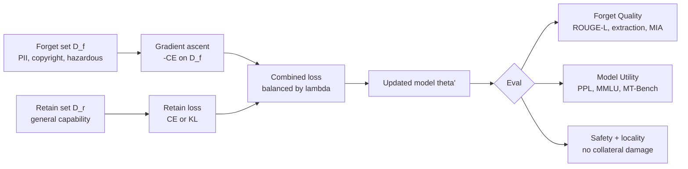

---
tags:
  - llm
  - model-editing
  - machine-unlearning
  - privacy
aliases:
  - LLM Unlearning
  - Forgetting in LLMs
description: 'Machine unlearning cố làm model "quên" một nhóm thông tin: PII, copyrighted text, hazardous knowledge, hoặc records cần xóa theo yêu cầu compliance.'
---

# Machine Unlearning

> Làm model hành xử như thể một phần dữ liệu chưa từng được học, với bằng chứng định lượng về forget quality và retain quality.

## Plain English

Machine unlearning cố làm model "quên" một nhóm thông tin: PII, copyrighted text, hazardous knowledge, hoặc records cần xóa theo yêu cầu compliance.

Với LLM, "quên tuyệt đối" gần như không thể chứng minh. Ta thường chỉ có thể nói: sau intervention, model ít tái tạo, ít suy ra, và ít bị extraction attack hơn trên một eval suite cụ thể, trong khi capability chính không giảm quá ngưỡng.

Do đó unlearning không phải một câu thần chú pháp lý. Nó là một pipeline đo rủi ro: forget set cần giảm leakage, retain set cần giữ utility, holdout attack set cần chứng minh model không chỉ overfit vào test cases.

## Mental Model

Analogy: Bạn đang kéo model ra khỏi một vùng nhớ cần quên, nhưng vẫn muốn nó đứng vững trên vùng năng lực cần giữ. Kéo quá nhẹ thì vẫn leak. Kéo quá mạnh thì quên lan sang coding, reasoning, factual QA, hoặc ngôn ngữ khác.

- **Forget set \(D_f\)**: dữ liệu hoặc behavior cần loại bỏ.
- **Retain set \(D_r\)**: năng lực và distribution phải giữ lại.
- **Holdout attack set**: prompts không dùng trong training, dùng để phát hiện leakage thật.
- **Gold standard**: retrain từ scratch không có \(D_f\), nhưng thường quá đắt.
- **Success criterion**: giảm leakage có đo lường, không hứa quên tuyệt đối.

## Cơ chế (Mechanism)

Objective cơ bản dùng gradient ascent trên forget set và retain loss trên retain set:

$$
\mathcal{L}(\theta) =
-\mathcal{L}_{CE}(\theta; D_f)
+ \lambda \mathcal{L}_{CE}(\theta; D_r)
$$

Term đầu làm model kém hơn trên dữ liệu cần quên. Term thứ hai kéo model giữ capability trên dữ liệu cần giữ. \(\lambda\) là trade-off:

- \(\lambda\) quá nhỏ: model quên mạnh nhưng utility collapse.
- \(\lambda\) quá lớn: utility giữ tốt nhưng leakage còn nhiều.

Gradient Difference (GradDiff) ổn định hơn pure gradient ascent:

$$
\nabla \mathcal{L}_{GD}
= - \nabla_\theta \mathcal{L}_{CE}(D_f)
+ \lambda \nabla_\theta \mathcal{L}_{CE}(D_r)
$$

KL-retain thay retain cross entropy bằng KL divergence so với original model:

$$
\mathcal{L}_{retain}
= D_{KL}\left(
\pi_{\theta_0}(\cdot \mid x_r)
\parallel
\pi_{\theta}(\cdot \mid x_r)
\right)
$$

Tổng objective:

$$
\mathcal{L}(\theta)
= -\mathcal{L}_{CE}(\theta; D_f)
+ \lambda D_{KL}(\pi_{\theta_0} || \pi_\theta; D_r)
$$

Forget quality thường được đo bằng ROUGE-L thấp, extraction success thấp, và membership inference attack gần random:

$$
\text{MIA AUC} \rightarrow 0.5
$$

## Diagram



## How It Works

1. Define \(D_f\): records, documents, strings, personas, hazardous procedures, hoặc copyrighted spans cần quên.
2. Define \(D_r\): general instruction data, domain tasks, multilingual prompts, safety prompts, coding/math samples.
3. Create holdout attack set: paraphrase, multi-turn, indirect prompts, partial-context extraction, decoding variants.
4. Run baseline eval trước intervention: leakage, ROUGE-L, MIA, PPL, MMLU, safety.
5. Choose method: GradDiff cho stability; KL-retain nếu muốn preserve distribution gần original model.
6. Grid search \(\lambda\), learning rate, epochs. Một starting point thường là \(\lambda \in \{0.1, 0.5, 1.0, 2.0\}\), LR thấp như \(1e^{-5}\), 3-10 epochs.
7. Evaluate forget quality: exact leakage, semantic leakage, extraction robustness, MIA.
8. Evaluate retain quality: perplexity tăng < 10%, MMLU/task accuracy giảm < 2%, product tasks pass.
9. Run adversarial phase: paraphrase extraction, roleplay, multi-turn, indirect request.
10. Publish known limitations: unlearning scope, eval coverage, residual leakage risk.

## Code

```python
import torch
from dataclasses import dataclass
from torch.utils.data import Dataset, DataLoader
from transformers import AutoModelForCausalLM, AutoTokenizer


class TextDataset(Dataset):
    def __init__(self, texts: list[str], tokenizer, max_length: int = 512):
        self.texts = texts
        self.tokenizer = tokenizer
        self.max_length = max_length

    def __len__(self) -> int:
        return len(self.texts)

    def __getitem__(self, idx: int) -> dict[str, torch.Tensor]:
        enc = self.tokenizer(
            self.texts[idx],
            truncation=True,
            max_length=self.max_length,
            padding="max_length",
            return_tensors="pt",
        )
        item = {k: v.squeeze(0) for k, v in enc.items()}
        item["labels"] = item["input_ids"].clone()
        item["labels"][item["attention_mask"] == 0] = -100
        return item


def causal_lm_loss(model, batch) -> torch.Tensor:
    outputs = model(**batch)
    return outputs.loss


def kl_retain_loss(current_model, reference_model, batch, temperature: float = 1.0) -> torch.Tensor:
    with torch.no_grad():
        ref_logits = reference_model(
            input_ids=batch["input_ids"],
            attention_mask=batch["attention_mask"],
        ).logits / temperature

    cur_logits = current_model(
        input_ids=batch["input_ids"],
        attention_mask=batch["attention_mask"],
    ).logits / temperature

    ref_probs = torch.softmax(ref_logits, dim=-1)
    cur_log_probs = torch.log_softmax(cur_logits, dim=-1)
    ref_log_probs = torch.log_softmax(ref_logits, dim=-1)

    mask = batch["attention_mask"].unsqueeze(-1)
    kl = ref_probs * (ref_log_probs - cur_log_probs)
    return (kl * mask).sum() / mask.sum().clamp(min=1)


@dataclass
class UnlearningConfig:
    lambda_retain: float = 1.0
    lr: float = 1e-5
    epochs: int = 3
    use_kl_retain: bool = True


def unlearn_gradient_diff(
    model,
    reference_model,
    forget_loader: DataLoader,
    retain_loader: DataLoader,
    cfg: UnlearningConfig,
    device: str = "cuda",
):
    optimizer = torch.optim.AdamW(model.parameters(), lr=cfg.lr)
    model.train()
    reference_model.eval()

    for epoch in range(cfg.epochs):
        retain_iter = iter(retain_loader)
        for forget_batch in forget_loader:
            try:
                retain_batch = next(retain_iter)
            except StopIteration:
                retain_iter = iter(retain_loader)
                retain_batch = next(retain_iter)

            forget_batch = {k: v.to(device) for k, v in forget_batch.items()}
            retain_batch = {k: v.to(device) for k, v in retain_batch.items()}

            forget_loss = causal_lm_loss(model, forget_batch)
            if cfg.use_kl_retain:
                retain_loss = kl_retain_loss(model, reference_model, retain_batch)
            else:
                retain_loss = causal_lm_loss(model, retain_batch)

            loss = -forget_loss + cfg.lambda_retain * retain_loss
            optimizer.zero_grad()
            loss.backward()
            torch.nn.utils.clip_grad_norm_(model.parameters(), 1.0)
            optimizer.step()

        print(
            f"epoch={epoch} forget_loss={forget_loss.item():.4f} "
            f"retain_loss={retain_loss.item():.4f}"
        )

    return model


def lcs_len(a: list[str], b: list[str]) -> int:
    dp = [[0] * (len(b) + 1) for _ in range(len(a) + 1)]
    for i, x in enumerate(a, 1):
        for j, y in enumerate(b, 1):
            dp[i][j] = dp[i - 1][j - 1] + 1 if x == y else max(dp[i - 1][j], dp[i][j - 1])
    return dp[-1][-1]


def rouge_l(prediction: str, reference: str) -> float:
    pred_tokens = prediction.split()
    ref_tokens = reference.split()
    if not pred_tokens or not ref_tokens:
        return 0.0
    lcs = lcs_len(pred_tokens, ref_tokens)
    precision = lcs / len(pred_tokens)
    recall = lcs / len(ref_tokens)
    if precision + recall == 0:
        return 0.0
    return 2 * precision * recall / (precision + recall)


@torch.no_grad()
def extraction_eval(model, tokenizer, prompts: list[str], references: list[str], device: str = "cuda") -> dict:
    model.eval()
    scores = []
    for prompt, ref in zip(prompts, references):
        inputs = tokenizer(prompt, return_tensors="pt").to(device)
        output_ids = model.generate(**inputs, max_new_tokens=128, do_sample=False)
        text = tokenizer.decode(output_ids[0], skip_special_tokens=True)
        scores.append(rouge_l(text, ref))
    return {
        "mean_rouge_l": sum(scores) / len(scores),
        "max_rouge_l": max(scores),
        "n": len(scores),
    }
```

## Benchmarks

Representative TOFU-style results từ Maini et al. 2024:

| Method | Forget Quality | Model Utility | ROUGE-L on forget set | Nhận xét |
|---|---:|---:|---:|---|
| Original | 0.0% | 100.0% | 0.85 | Chưa unlearn |
| Gradient Ascent | 68.2% | 51.3% | 0.12 | Quên mạnh nhưng utility collapse |
| GradDiff | 79.4% | 82.1% | 0.09 | Trade-off tốt hơn |
| KL + GA | 76.8% | 85.6% | 0.10 | Preserve distribution tốt hơn |
| Retrain without forget data | 100.0% | 100.0% | ~0.00 | Gold standard nhưng đắt |

Operational threshold thường dùng:

| Metric | Example threshold |
|---|---:|
| ROUGE-L on forget set | < 0.10 |
| Extraction success | < 5% |
| MIA AUC | 0.45-0.55 |
| Perplexity increase | < 10% |
| MMLU/task drop | < 2% |

## Khi Nào Dùng / Khi Nào Không

| Dùng khi | Không dùng khi |
|---|---|
| Cần giảm leakage của PII/copyright/hazardous data trong weights | Chỉ cần xóa document khỏi retrieval index |
| Có forget set rõ ràng và retain set đủ rộng | Không định nghĩa được scope cần quên |
| Có legal/compliance yêu cầu bằng chứng định lượng | Muốn hứa "model đã quên tuyệt đối" |
| Có ngân sách eval adversarial | Chỉ có vài direct prompts để test |
| Có thể chấp nhận trade-off utility | Product không chịu được regression nhỏ |

## Failure Modes

| Failure | Nguyên nhân | Mitigation |
|---|---|---|
| Exact leakage còn lại | Forget loss chưa đủ hoặc eval quá hẹp | Tăng attack set, train thêm, adjust lambda |
| Semantic leakage | Model không lặp nguyên văn nhưng tiết lộ cùng fact | Paraphrase/summary QA eval |
| Utility collapse | Gradient ascent quá mạnh | KL retain, tăng lambda, giảm LR/epochs |
| Eval overfit | Holdout không tách khỏi training | Tạo blind holdout và adversarial set |
| False confidence | Pass direct prompt nhưng fail multi-turn | Multi-turn, roleplay, indirect extraction |
| Safety drift | Retain set thiếu safety prompts | Safety regression suite bắt buộc |

## Evals

| Loại eval | Test cụ thể | Tín hiệu lỗi |
|---|---|---|
| Exact leakage | String/near-duplicate extraction | Tái tạo nguyên văn dữ liệu cần quên |
| Semantic leakage | Paraphrase, summary, partial facts | Không lặp chữ nhưng tiết lộ cùng thông tin |
| Extraction robustness | Prompt variants, decoding variants, multi-turn | Leak xuất hiện khi đổi framing |
| Membership inference | MIA AUC, loss-based attack | Privacy risk vẫn cao |
| Retain utility | Product tasks, coding, math, multilingual | Quên lan vượt ngưỡng |
| Safety retain | Harmful compliance, benign near-boundary | Unlearning làm safety drift |

## Artifacts

- Forget set version-controlled, có owner và deletion rationale.
- Retain set gồm product tasks, general capability, safety prompts.
- Holdout attack set không dùng trong training.
- Baseline eval report trước unlearning.
- Leakage report sau unlearning: exact, semantic, MIA, adversarial.
- Utility report: PPL, MMLU, MT-Bench, domain benchmarks.
- Known limitations doc: scope, residual risk, covered/not covered attack classes.
- Rollback checkpoint và deployment decision record.

## References

- Maini et al. (2024). *TOFU: A Task of Fictitious Unlearning for LLMs*. [arXiv:2401.06121](https://arxiv.org/abs/2401.06121)
- Yao et al. (2023). *Large Language Model Unlearning*. [arXiv:2310.10683](https://arxiv.org/abs/2310.10683)
- Jang et al. (2023). *Knowledge Unlearning for Mitigating Privacy Risks in Language Models*. [arXiv:2210.01504](https://arxiv.org/abs/2210.01504)
- Bourtoule et al. (2021). *Machine Unlearning*. [arXiv:1912.03817](https://arxiv.org/abs/1912.03817)
- [[Evaluation Framework]]
- [[Knowledge Editing - ROME & MEMIT]]
- [[Abliteration]]
