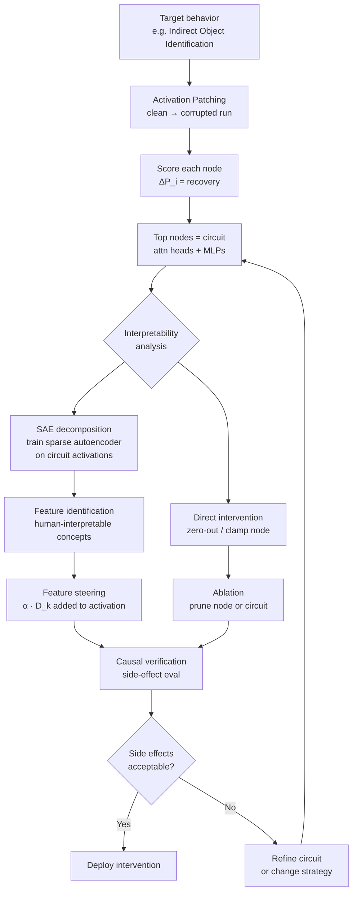

# Neuron, Circuit & Feature Edits

> **Tóm tắt:** Nhóm kỹ thuật này cố gắng *hiểu cơ chế* gây ra hành vi trước khi can thiệp — ngược với ROME hay activation steering vốn target black-box. Workflow gồm ba bước: (1) dùng activation patching để tìm nodes nhân quả, (2) tùy chọn dùng Sparse Autoencoder để tách features dễ diễn giải, (3) ablate/steer chính xác rồi verify side-effects. Chậm và tốn công hơn, nhưng khi làm đúng, đây là phương pháp phẫu thuật chính xác nhất hiện có.

---

## Plain English

Hầu hết các kỹ thuật chỉnh sửa model đều có chung một giả định ngầm: "chúng ta không cần hiểu model, chỉ cần tìm chỗ để thay đổi." Mechanistic interpretability từ chối giả định đó.

Thay vào đó, câu hỏi là: *attention head nào, MLP layer nào, neuron nào thực sự gây ra hành vi X?* Và quan trọng hơn: liệu đó có phải là nguyên nhân thật sự (causal), hay chỉ là tương quan (correlation)?

Công cụ chính để trả lời là **activation patching**: chạy model trên hai input (clean và corrupted), lấy activation của một node từ clean run, nhét vào corrupted run tại đúng vị trí đó, rồi đo xem output có phục hồi không. Nếu phục hồi nhiều ($\Delta P$ cao), node đó nhân quả với behavior.

Vấn đề nổi tiếng: *polysemanticity*. Một neuron không chứa một concept sạch — nó chứa nhiều concept chồng lên nhau (superposition). Sparse Autoencoder (SAE) học một dictionary overcomplete để tách activation thành các *features* sparse, monosemantic hơn nhiều, dễ diễn giải và dễ can thiệp hơn.

---

## Mental Model

> **Analogy:** Đừng nghĩ một neuron là một khái niệm. Hãy nghĩ weights của LLM như một tòa nhà có hàng triệu dây điện chạy chồng chéo nhau. Khi bạn tắt một bóng đèn (neuron), bạn không biết có bao nhiêu căn phòng bị ảnh hưởng. Circuit discovery giống như đi theo từng dây điện từ công tắc đến bóng đèn để vẽ sơ đồ mạch thật sự. SAE giống như tách bundle dây chằng chịt thành từng dây đơn có nhãn.

**Các điểm cốt lõi cần nhớ:**

- **Correlation chưa đủ** — cần causal test qua activation patching để xác nhận node thật sự gây ra behavior.
- **SAE tách features** dễ diễn giải hơn neurons thô — overcomplete dictionary với sparsity constraint.
- **Ablation/pruning phải đo side-effects rộng** — circuit nhỏ nhưng ablate sai có thể phá general capability.
- **Circuit = subgraph** của attention heads + MLP layers gây ra một behavior cụ thể, có thể rất nhỏ (2–5% total params).
- **Polysemanticity là rule, không phải exception** trong LLMs — một neuron thường chứa 3–5+ unrelated concepts.

---

## Cơ chế (Mechanism)

### Activation Patching

Cho clean input $x^*$ và corrupted input $x$. Gọi $a_i^*$ là activation tại node $i$ khi chạy $x^*$, và $a_i$ là activation khi chạy $x$.

**Patching experiment:** Thay $a_i$ bằng $a_i^*$ trong corrupted run, đo recovery:

$$
\Delta P_i = P(y^* \mid \text{patch node } i) - P(y^* \mid \text{corrupted run})
$$

$\Delta P_i$ cao → node $i$ là nhân quả với behavior. Chạy cho tất cả nodes → **importance scores** cho từng attention head và MLP.

**Path patching** (Goldowsky-Dill et al. 2023): thay vì patch node, patch *edge* giữa hai nodes để tìm information flow paths trong circuit.

### Circuit Discovery (ACDC)

Automated Circuit DisCovery: dùng activation patching với threshold để tự động giữ lại subgraph:

$$
\mathcal{C} = \{i : \Delta P_i > \epsilon\}
$$

Lặp lại: bắt đầu từ output, đi ngược lên các edges, prune edges có $\Delta P < \epsilon$, cho đến khi circuit converges.

### Sparse Autoencoder (SAE)

Học dictionary $D \in \mathbb{R}^{d \times n_f}$ với $n_f \gg d$ (overcomplete) để biểu diễn activation $h \in \mathbb{R}^d$:

$$
\hat{h} = D \cdot f(h), \quad f = \text{ReLU}(W_e \cdot h + b_e)
$$

**Loss function:**

$$
\mathcal{L} = \underbrace{\|h - \hat{h}\|^2}_{\text{reconstruction}} + \underbrace{\lambda \|f(h)\|_1}_{\text{sparsity}}
$$

$f(h)$ là feature activations — sparse vector, hầu hết bằng 0. Mỗi chiều $f_k(h)$ là một *feature* với hướng diễn giải cụ thể trong activation space.

**Feature steering:** để steer model theo feature $k$, cộng $\alpha \cdot D_{:,k}$ vào activation tại layer target:

$$
h_{\text{steered}} = h + \alpha \cdot D_{:,k}
$$

### Causal Scrubbing

Kiểm tra xem một circuit hypothesis $\mathcal{H}$ có giải thích đủ behavior không:

$$
\text{KL}(P_{\text{original}} \| P_{\text{resample\_ablation}}) \approx 0
$$

Nếu resample ablation (thay activations outside circuit bằng random samples) không làm thay đổi output distribution, circuit $\mathcal{H}$ là *sufficient explanation*.

---

## Diagram



---

## How It Works — Step-by-Step

**Bước 1 — Định nghĩa behavior cần phân tích**
Cụ thể hóa: "model dự đoán đúng indirect object trong câu như *John gave Mary the...* → *book*". Cần cặp (clean prompt, corrupted prompt) và target token. Corrupted prompt thường là swapped entities hoặc semantically broken version.

**Bước 2 — Chạy activation patching**
Với mỗi attention head $(l, h)$ và MLP $l$: patch activation từ clean run vào corrupted run, đo $\Delta P$. Kết quả là heatmap $\Delta P$ theo layer × component.

**Bước 3 — Xác định circuit**
Giữ các nodes có $\Delta P > \epsilon$ (threshold thường 0.1–0.2). Chạy path patching để xác định edges (information flow). Verify circuit bằng ablation: xóa circuit → behavior should break.

**Bước 4 — (Tùy chọn) SAE decomposition**
Nếu cần diễn giải sâu hơn: train SAE trên residual stream hoặc MLP output tại các layers trong circuit. Identify features liên quan đến behavior target. Max-activation examples: tìm dataset examples kích hoạt feature cao nhất để hiểu feature meaning.

**Bước 5 — Causal verification**
Ablate hoặc steer circuit nodes, verify behavior thay đổi đúng hướng. Quan trọng: chạy causal scrubbing — nếu circuit đủ, behavior ngoài circuit không đổi.

**Bước 6 — Side-effect audit**
Đo performance trên ≥5 unrelated tasks sau intervention. Side effects lớn → circuit too coarse hoặc intervention too broad. Narrow down hoặc dùng softer steering.

---

## Code

```python
import torch
from transformers import AutoTokenizer, AutoModelForCausalLM
from typing import Callable


def activation_patch_score(
    model: AutoModelForCausalLM,
    tokenizer: AutoTokenizer,
    clean_prompt: str,
    corrupted_prompt: str,
    target_token: str,
    layer_idx: int,
    component: str = "mlp",  # "mlp" hoặc "attn"
    device: str = "cuda",
) -> float:
    """
    Tính ΔP = P(target | patched) - P(target | corrupted).
    component="mlp" patches MLP output, "attn" patches attention output.
    """
    model.eval()
    target_id = tokenizer.encode(f" {target_token}", add_special_tokens=False)[0]

    # --- Bước 1: Lưu clean activation ---
    clean_acts: dict[str, torch.Tensor] = {}
    save_hooks = []

    def make_save_hook(key: str):
        def hook(module, input, output):
            h = output[0] if isinstance(output, tuple) else output
            clean_acts[key] = h.detach().clone()
        return hook

    layer = model.model.layers[layer_idx]
    target_module = layer.mlp if component == "mlp" else layer.self_attn
    save_hooks.append(target_module.register_forward_hook(make_save_hook(component)))

    with torch.no_grad():
        clean_ids = tokenizer(clean_prompt, return_tensors="pt").to(device)
        model(**clean_ids)

    for h in save_hooks:
        h.remove()

    # --- Bước 2: Corrupted baseline (không patch) ---
    with torch.no_grad():
        corr_ids = tokenizer(corrupted_prompt, return_tensors="pt").to(device)
        corr_out = model(**corr_ids)
        corr_p = torch.softmax(corr_out.logits[0, -1], dim=-1)[target_id].item()

    # --- Bước 3: Patch clean activation vào corrupted run ---
    patch_hooks = []

    def make_patch_hook(key: str):
        def hook(module, input, output):
            saved = clean_acts[key]
            if isinstance(output, tuple):
                return (saved,) + output[1:]
            return saved
        return hook

    patch_hooks.append(target_module.register_forward_hook(make_patch_hook(component)))

    with torch.no_grad():
        patch_out = model(**corr_ids)
        patch_p = torch.softmax(patch_out.logits[0, -1], dim=-1)[target_id].item()

    for h in patch_hooks:
        h.remove()

    return patch_p - corr_p  # ΔP


def full_patching_sweep(
    model: AutoModelForCausalLM,
    tokenizer: AutoTokenizer,
    clean_prompt: str,
    corrupted_prompt: str,
    target_token: str,
    device: str = "cuda",
) -> dict[str, list[float]]:
    """
    Chạy activation patching cho tất cả layers và components.
    Trả về {"mlp": [ΔP per layer], "attn": [ΔP per layer]}.
    """
    n_layers = model.config.num_hidden_layers
    results = {"mlp": [], "attn": []}

    for layer_idx in range(n_layers):
        for component in ["mlp", "attn"]:
            score = activation_patch_score(
                model, tokenizer,
                clean_prompt, corrupted_prompt, target_token,
                layer_idx, component, device
            )
            results[component].append(score)
            print(f"Layer {layer_idx:02d} {component}: ΔP = {score:.4f}")

    return results


class SparseAutoencoder(torch.nn.Module):
    """
    Sparse Autoencoder để học overcomplete dictionary.
    n_features >> d_model để đạt monosemanticity.
    """

    def __init__(self, d_model: int, n_features: int):
        super().__init__()
        self.d_model = d_model
        self.n_features = n_features
        self.encoder = torch.nn.Linear(d_model, n_features, bias=True)
        self.decoder = torch.nn.Linear(n_features, d_model, bias=False)
        self.relu = torch.nn.ReLU()

        # Decoder columns normalized (unit sphere)
        torch.nn.init.orthogonal_(self.decoder.weight)

    def encode(self, x: torch.Tensor) -> torch.Tensor:
        """Trả về feature activations (sparse)."""
        return self.relu(self.encoder(x))

    def decode(self, f: torch.Tensor) -> torch.Tensor:
        return self.decoder(f)

    def forward(self, x: torch.Tensor) -> tuple[torch.Tensor, torch.Tensor]:
        f = self.encode(x)
        x_hat = self.decode(f)
        return x_hat, f

    def loss(self, x: torch.Tensor, l1_coeff: float = 1e-3) -> torch.Tensor:
        """
        L = ||x - x_hat||^2 + λ * ||f||_1
        """
        x_hat, f = self.forward(x)
        recon_loss = ((x - x_hat) ** 2).mean()
        sparsity_loss = f.abs().mean()
        return recon_loss + l1_coeff * sparsity_loss

    def normalize_decoder(self):
        """Giữ decoder columns trên unit sphere sau mỗi gradient step."""
        with torch.no_grad():
            norms = self.decoder.weight.norm(dim=0, keepdim=True).clamp(min=1.0)
            self.decoder.weight.div_(norms)


def train_sae(
    activations: torch.Tensor,  # shape: [n_samples, d_model]
    n_features: int = 16384,
    l1_coeff: float = 1e-3,
    n_epochs: int = 10,
    batch_size: int = 1024,
    lr: float = 1e-4,
    device: str = "cuda",
) -> SparseAutoencoder:
    """Train SAE trên collected activations."""
    d_model = activations.shape[-1]
    sae = SparseAutoencoder(d_model, n_features).to(device)
    optimizer = torch.optim.Adam(sae.parameters(), lr=lr)
    dataset = torch.utils.data.TensorDataset(activations.to(device))
    loader = torch.utils.data.DataLoader(dataset, batch_size=batch_size, shuffle=True)

    for epoch in range(n_epochs):
        total_loss = 0.0
        for (batch,) in loader:
            optimizer.zero_grad()
            loss = sae.loss(batch, l1_coeff)
            loss.backward()
            optimizer.step()
            sae.normalize_decoder()
            total_loss += loss.item()
        avg_loss = total_loss / len(loader)
        print(f"Epoch {epoch+1}/{n_epochs} | Loss: {avg_loss:.6f}")

    return sae


def steer_with_feature(
    model: AutoModelForCausalLM,
    sae: SparseAutoencoder,
    feature_idx: int,
    steering_strength: float,
    layer_idx: int,
    prompt: str,
    tokenizer: AutoTokenizer,
    max_new_tokens: int = 50,
    device: str = "cuda",
) -> str:
    """
    Steer model bằng cách cộng feature direction vào residual stream.
    feature_direction = decoder column cho feature_idx.
    """
    feature_direction = sae.decoder.weight[:, feature_idx].detach()  # [d_model]

    steer_hooks = []

    def steer_hook(module, input, output):
        h = output[0] if isinstance(output, tuple) else output
        h = h + steering_strength * feature_direction.to(h.device)
        if isinstance(output, tuple):
            return (h,) + output[1:]
        return h

    layer = model.model.layers[layer_idx]
    steer_hooks.append(layer.register_forward_hook(steer_hook))

    input_ids = tokenizer(prompt, return_tensors="pt").input_ids.to(device)
    with torch.no_grad():
        output_ids = model.generate(input_ids, max_new_tokens=max_new_tokens)

    for h in steer_hooks:
        h.remove()

    return tokenizer.decode(output_ids[0][input_ids.shape[1]:], skip_special_tokens=True)
```

---

## Benchmarks

### Wang et al. (2022) — Indirect Object Identification (IOI) Circuit, GPT-2

| Metric | Value | Notes |
|---|---|---|
| Circuit size | 26 attention heads | ~3% of all heads in GPT-2 |
| Task accuracy (full model) | 94% | Baseline |
| Task accuracy (circuit ablated) | 12% | Circuit is necessary |
| Behavior explained by top 4 components | >80% | Highly concentrated |
| Path patching edges identified | ~15 key edges | Fine-grained information flow |

### Anthropic SAE — Templeton et al. (2024), Claude 3 Sonnet

| Metric | Value | Notes |
|---|---|---|
| Features identified (1 layer) | 34 million | Massively overcomplete |
| Clearly interpretable features | ~15–20% | Human raters agree on meaning |
| Feature steering coherence | High | "banana" feature → coherent banana outputs |
| Dead features (never activate) | ~5–10% | Wasted capacity |
| L0 sparsity (avg features active) | ~20–50 / token | Out of 34M total features |

### Conmy et al. (2023) — ACDC Automated Circuit Discovery

| Task | Circuit Size (% params) | Accuracy Preserved |
|---|---|---|
| Indirect Object Identification | 2.1% | 91% |
| Docstring completion | 3.4% | 88% |
| Greater-than | 1.8% | 94% |
| Modular arithmetic | 4.7% | 87% |
| Average across 6 tasks | ~2.9% | ~90% |

Circuits nhỏ (~3% params) có thể giải thích ~90% của task behavior.

### Meng et al. (2022) — Causal Tracing (ROME, GPT-J)

| Layer Range | Causal Effect ($\Delta P$) | Interpretation |
|---|---|---|
| Layers 1–5 (early MLP) | Low | General processing |
| Layers 6–10 (mid MLP) | High (0.3–0.5) | Factual storage |
| Layers 11–15 (late MLP) | Medium | Recall |
| Attention heads (all) | Low–Medium | Information routing |

Early-to-mid MLPs là vị trí chính lưu trữ factual associations.

---

## Khi Nào Dùng / Khi Nào Không

> [!success] Dùng khi
> - Cần **phẫu thuật chính xác** — biết chính xác node nào gây ra behavior để can thiệp tối thiểu.
> - Đang **debug unexpected behavior**: model làm gì đó lạ và muốn biết tại sao.
> - Cần **causal evidence** cho safety claim (không chỉ black-box eval).
> - Muốn **disable một behavior cụ thể** mà không ảnh hưởng các behavior khác.
> - Nghiên cứu về model internals, superposition, hoặc feature geometry.

> [!danger] Không dùng khi
> - Cần kết quả nhanh — circuit discovery tốn nhiều compute và engineering.
> - Behavior **phân tán quá rộng** qua toàn bộ model (không có circuit nhỏ nào đủ).
> - Không có cặp (clean, corrupted) prompts đủ contrastive để patching có ý nghĩa.
> - Model quá lớn mà không có infrastructure patching hiệu quả (vd: GPT-4 scale, proprietary).
> - Chỉ cần suppress một behavior — [[Abliteration]] hay [[Activation Steering]] nhanh hơn nhiều.

---

## Failure Modes

| Failure Mode | Nguyên nhân | Mitigation |
|---|---|---|
| **Polysemanticity** — neuron chứa nhiều concepts | Superposition: LLM nén nhiều features vào ít neurons | SAE decomposition trước khi interpret; đừng trust single-neuron analysis |
| **False circuit** — correlation không phải causation | Activation patching chỉ cho biết information flows through, không phải node is necessary | Causal scrubbing verification; ablate circuit và test |
| **Incomplete circuit** — circuit chỉ giải thích một phần | Complex behavior có nhiều sub-circuits | Iterate với lower threshold; path patching để tìm edges bị bỏ sót |
| **Side-effect** — ablation ảnh hưởng unrelated tasks | Circuit overlap với circuits của tasks khác | Broad side-effect eval trước deploy; soft steering thay vì hard ablation |
| **Transfer gap** — circuit đúng cho một prompt template | Circuit overfit vào surface features của test set | Test nhiều prompt variants, paraphrases, và languages |
| **SAE feature polysemanticity** — feature vẫn không sạch | n_features quá nhỏ hoặc l1_coeff quá nhỏ | Tăng n_features; tune l1; kiểm tra max-activation examples |

---

## Evals

| Loại | Test | Tín hiệu lỗi |
|---|---|---|
| **Causal effect** | Ablate circuit nodes → task accuracy should drop significantly (>50%) | ΔP thấp = node không nhân quả, chỉ là correlation |
| **Circuit completeness** | Resample ablation ngoài circuit → output distribution không đổi (causal scrubbing) | Circuit chỉ giải thích một phần nhỏ của behavior |
| **Circuit minimality** | Thêm lại từng node đã bị prune → accuracy không tăng | Circuit chứa redundant nodes |
| **Feature interpretability** | Human raters xem max-activation examples, đánh giá concept clarity | Feature polysemantic = nhiều raters disagreement |
| **Steering coherence** | Steer feature lên α cao → outputs liên quan đến feature concept | Feature steering gây gibberish = feature không interpretable |
| **Side-effects** | Performance trên ≥5 unrelated tasks sau intervention | Intervention quá broad, phá general capability |
| **Transfer** | Test circuit trên nhiều prompt templates, không chỉ template dùng khi discovery | Circuit chỉ đúng cho một surface form |

---

## Artifacts

Phải lưu đầy đủ để reproduce và audit:

- **Circuit diagram** — nodes (layer, component) + edges (information flow paths)
- **Activation patching heatmap** — $\Delta P$ scores theo layer × component, với threshold được dùng
- **SAE training config** — n_features, l1_coeff, n_epochs, data source, layer targeted
- **Side-effect audit report** — performance trước/sau intervention trên unrelated tasks
- **Causal evidence doc** — clean/corrupted prompt pairs, target tokens, recovery scores
- **Max-activation examples** — dataset examples kích hoạt mỗi feature cao nhất (để interpret)

---

## References

- Wang et al. (2022). *Interpretability in the Wild: a Circuit for Indirect Object Identification in GPT-2 Small*. [arXiv:2211.00593](https://arxiv.org/abs/2211.00593)
- Meng et al. (2022). *Locating and Editing Factual Associations in GPT* (causal tracing). [arXiv:2202.05262](https://arxiv.org/abs/2202.05262)
- Templeton et al. (2024). *Scaling Monosemanticity: Extracting Interpretable Features from Claude 3 Sonnet*. Anthropic Research Blog.
- Conmy et al. (2023). *Towards Automated Circuit Discovery for Mechanistic Interpretability*. [arXiv:2304.14997](https://arxiv.org/abs/2304.14997)
- Goldowsky-Dill et al. (2023). *Localizing Model Behavior with Path Patching*. [arXiv:2304.05969](https://arxiv.org/abs/2304.05969)
- Chan et al. (2022). *Causal Scrubbing: a method for rigorously testing interpretability hypotheses*. Alignment Forum.
- [[Abliteration]] — application của direction finding, nhanh hơn nhưng ít interpretable hơn
- [[Activation Steering]] — intervention sau circuit discovery, sử dụng kết quả patching
- [[Knowledge Editing - ROME & MEMIT]] — causal tracing là core của ROME, cùng paradigm
- [[LLM Model Editing - MOC]] — map toàn bộ các kỹ thuật
