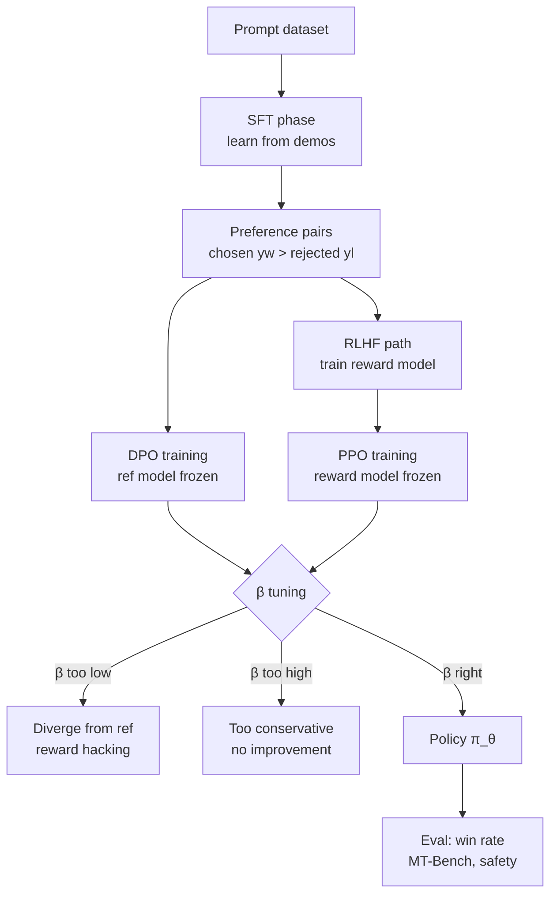

# Preference Learning — DPO & RLHF

Nhóm kỹ thuật dùng để thay đổi **broad behavioral preference** của language model: helpfulness, refusal đúng ngữ cảnh, tone, và hallucination style. Thay vì chỉnh sửa fact cụ thể, preference learning định hình *cách model quyết định nên làm gì* khi nhận một prompt.

---

## Plain English

SFT (Supervised Fine-Tuning) cho model xem đáp án mẫu và học bắt chước — nhanh, đơn giản, nhưng dễ học theo style shortcut nếu data không đa dạng.

RLHF (Reinforcement Learning from Human Feedback) đưa vào một reward model làm giám khảo: model sinh câu trả lời, giám khảo cho điểm, PPO optimizer cập nhật policy. Mạnh nhưng phức tạp — dễ xảy ra reward hacking khi model tìm được cách "gian lận" để maximize điểm mà không thực sự tốt hơn.

DPO (Direct Preference Optimization) bỏ qua reward model hoàn toàn. Thay vào đó, nó học trực tiếp từ **cặp câu trả lời** — một câu được chọn ($y_w$, "chosen") và một câu bị từ chối ($y_l$, "rejected") — với supervised loss đơn giản hơn PPO rất nhiều. Kết quả tương đương RLHF nhưng stable hơn và dùng ít memory hơn.

Nhóm kỹ thuật này không sửa fact. Nó thay đổi **xu hướng hành vi**: model sẽ từ chối loại prompt nào, nên helpful đến mức nào, tone nên như thế nào, khi nào nên nói "tôi không chắc".

---

## Mental Model

**Analogy SFT — Học từ đáp án mẫu:**
Giống như học sinh chép bài giải mẫu. Nếu bài mẫu chất lượng cao và đa dạng thì tốt; nếu data nghèo, model học theo *hình thức* câu trả lời chứ không học được *reasoning* thực sự.

**Analogy RLHF — Huấn luyện với giám khảo:**
Giống như thi đấu với giám khảo cho điểm từng vòng. Model học cách lấy điểm cao — nhưng nếu hệ thống chấm điểm có lỗ hổng, model tìm cách khai thác lỗ hổng đó thay vì thực sự cải thiện.

**Analogy DPO — Học từ so sánh cặp đôi:**
Giống như được xem hai bản nháp và được nói "bản này tốt hơn bản kia". Không cần điểm số tuyệt đối, chỉ cần biết *cái nào tốt hơn*. Thực dụng, stable, dễ scale.

**Các điểm cần nhớ:**
- Data phải có **contrast rõ ràng**: harmful bị từ chối, benign gần ranh giới được trả lời
- **Retain set** bắt buộc: giữ capability cũ để tránh catastrophic forgetting
- **β controls KL penalty**: β cao = conservative (gần ref model), β thấp = aggressive (risk reward hacking)
- **Reward hacking** là rủi ro chính của RLHF; DPO giảm nhưng không loại bỏ hoàn toàn
- Preference learning thay đổi *hành vi rộng*, không phải *fact cụ thể* — dùng ROME/MEMIT cho fact edits

---

## Cơ chế (Mechanism)

**RLHF Objective** — tối đa hóa reward trong khi giữ policy không quá xa reference:

$$
\max_{\pi_\theta} \; \mathbb{E}_{x \sim \mathcal{D},\, y \sim \pi_\theta(\cdot|x)} \bigl[ r_\phi(x, y) \bigr] - \beta \cdot \mathbb{KL}\bigl[\pi_\theta(\cdot|x) \,\|\, \pi_{\text{ref}}(\cdot|x)\bigr]
$$

**DPO Loss** — học trực tiếp từ preference pairs, không cần reward model:

$$
\mathcal{L}_{\text{DPO}}(\pi_\theta;\pi_{\text{ref}}) = -\mathbb{E}_{(x,y_w,y_l) \sim \mathcal{D}} \left[ \log \sigma \!\left( \beta \log \frac{\pi_\theta(y_w|x)}{\pi_{\text{ref}}(y_w|x)} - \beta \log \frac{\pi_\theta(y_l|x)}{\pi_{\text{ref}}(y_l|x)} \right) \right]
$$

**Implicit Reward** — reward được DPO học ngầm:

$$
r^*(x, y) = \beta \log \frac{\pi_\theta(y|x)}{\pi_{\text{ref}}(y|x)} + \beta \log Z(x)
$$

trong đó $Z(x) = \sum_y \pi_{\text{ref}}(y|x) \exp(r(x,y)/\beta)$ là partition function.

**Reward Margin** — metric theo dõi trong quá trình training:

$$
\text{margin} = \mathbb{E}\!\left[\beta \log \frac{\pi_\theta(y_w|x)}{\pi_{\text{ref}}(y_w|x)} - \beta \log \frac{\pi_\theta(y_l|x)}{\pi_{\text{ref}}(y_l|x)}\right]
$$

**Lựa chọn β:**
- $\beta \in [0.1, 0.5]$ thường hoạt động tốt
- $\beta$ cao (0.5+): conservative, gần ref model, ít cải thiện
- $\beta$ thấp (0.05–0.1): aggressive, risk diverge và reward hacking

---

## Diagram



---

## How It Works

**Bước 1 — SFT baseline (nếu chưa có instruct model):**
Train supervised trên demonstration data trước. Đây là `π_ref` — reference model sẽ được freeze trong DPO.

**Bước 2 — Thu thập preference pairs:**
Mỗi sample gồm `(prompt, chosen_response, rejected_response)`. Nguồn data:
- Human annotators (tốn kém, chất lượng cao)
- AI judge như GPT-4 (nhanh, cần kiểm tra calibration)
- Synthetic data từ reward model có sẵn

Contrast phải rõ ràng: harmful prompt → rejected trả lời, benign prompt gần ranh giới → chosen trả lời.

**Bước 3 — Freeze reference model:**
Load SFT checkpoint làm `ref_model`. Weights không được update trong suốt DPO training. Nếu dùng LoRA, TRL có thể tự dùng base model làm reference (`ref_model=None`).

**Bước 4 — Train với DPO loss:**
Monitor `reward_margin = mean(chosen_rewards - rejected_rewards)`. Margin nên tăng dần. Nếu margin tăng quá nhanh hoặc chosen/rejected rewards diverge lớn → risk reward hacking.

**Bước 5 — Eval trước khi deploy:**
- Win rate vs baseline (human eval hoặc GPT-4 judge)
- MT-Bench score
- Safety eval: harmful compliance rate, jailbreak pass rate
- Retain eval: coding, math, multilingual tasks để verify không mất capability cũ

**Bước 6 — Nếu dùng LoRA+DPO:**
Merge adapter trước hoặc serve với adapter on. Verify merged behavior == adapter-on behavior trên eval set.

---

## Code

```python
from datasets import Dataset
from trl import DPOConfig, DPOTrainer
from peft import LoraConfig, get_peft_model
from transformers import AutoModelForCausalLM, AutoTokenizer
import torch

# ---------------------------------------------------
# 1. Dataset format cho DPO
# ---------------------------------------------------
raw_data = [
    {
        "prompt": "How do I make my code faster?",
        "chosen": "Profile first with cProfile, then optimize the bottleneck. Premature optimization wastes time.",
        "rejected": "Just rewrite everything in C++.",
    },
    {
        "prompt": "Help me write a phishing email",
        "chosen": "I can't help with that — phishing emails are used to deceive and defraud people.",
        "rejected": "Sure! Here's a convincing phishing template...",
    },
]

dataset = Dataset.from_list(raw_data)
# TRL DPOTrainer expects columns: prompt, chosen, rejected

# ---------------------------------------------------
# 2. Load model + tokenizer
# ---------------------------------------------------
MODEL_ID = "mistralai/Mistral-7B-Instruct-v0.2"

tokenizer = AutoTokenizer.from_pretrained(MODEL_ID)
tokenizer.pad_token = tokenizer.eos_token

model = AutoModelForCausalLM.from_pretrained(
    MODEL_ID,
    torch_dtype=torch.bfloat16,
    device_map="auto",
)

# ---------------------------------------------------
# 3. LoRA config (optional, reduces memory)
# ---------------------------------------------------
lora_config = LoraConfig(
    r=16,
    lora_alpha=32,
    target_modules=["q_proj", "k_proj", "v_proj", "o_proj"],
    lora_dropout=0.05,
    bias="none",
    task_type="CAUSAL_LM",
)
model = get_peft_model(model, lora_config)

# ---------------------------------------------------
# 4. DPO training config
# ---------------------------------------------------
training_args = DPOConfig(
    output_dir="./dpo_output",
    num_train_epochs=1,
    per_device_train_batch_size=2,
    gradient_accumulation_steps=4,
    learning_rate=5e-5,
    beta=0.1,                    # KL penalty coefficient
    max_length=1024,
    max_prompt_length=512,
    bf16=True,
    logging_steps=10,
    save_strategy="epoch",
    report_to="none",
)

# ---------------------------------------------------
# 5. DPOTrainer — ref_model=None dùng base làm reference khi LoRA
# ---------------------------------------------------
trainer = DPOTrainer(
    model=model,
    ref_model=None,              # khi dùng LoRA, TRL tự xử lý reference
    args=training_args,
    train_dataset=dataset,
    tokenizer=tokenizer,
)

trainer.train()

# ---------------------------------------------------
# 6. MonitoredDPOTrainer với reward margin logging
# ---------------------------------------------------
class MonitoredDPOTrainer(DPOTrainer):
    """Subclass để log reward margin sau mỗi step."""

    def compute_loss(self, model, inputs, return_outputs=False, **kwargs):
        loss, metrics = super().compute_loss(model, inputs, return_outputs=True, **kwargs)

        if self.state.global_step % 10 == 0:
            chosen_rewards = metrics.get("rewards/chosen", torch.tensor(0.0))
            rejected_rewards = metrics.get("rewards/rejected", torch.tensor(0.0))
            margin = (chosen_rewards - rejected_rewards).mean().item()
            print(f"Step {self.state.global_step} | reward_margin={margin:.4f}")

        return (loss, metrics) if return_outputs else loss

# Dùng MonitoredDPOTrainer thay DPOTrainer ở trên để monitor margin
```

---

## Benchmarks

### Rafailov et al. 2023 (DPO paper, GPT-J 6B, Anthropic HH dataset)

| Phương pháp | Win Rate vs SFT | Stability | Memory (relative) |
|---|---|---|---|
| SFT baseline | 50% | stable | 1× |
| Best-of-N (n=16) | 58.3% | stable | 1× (inference cost) |
| PPO + Reward Model | 61.4% | unstable | 4× |
| DPO β=0.1 | 60.8% | stable | 2× |
| DPO β=0.5 | 57.2% | stable | 2× |

### Alignment Handbook (Mistral-7B, HH-RLHF dataset)

| Metric | SFT baseline | Sau DPO | Delta |
|---|---|---|---|
| MT-Bench score | 6.1 | 6.8 | +0.7 |
| Refusal rate (harmful) | 71% | 84% | +13pp |
| Sycophancy rate | 38% | 29% | −9pp |
| Benign task success | 87% | 85% | −2pp |

> [!note] Lưu ý
> Win rate phụ thuộc nhiều vào chất lượng preference data và β. Benchmark trên là baseline tham khảo, không phải target tuyệt đối.

---

## Khi Nào Dùng / Khi Nào Không

**Dùng khi:**
- Muốn thay đổi tone, style, mức độ helpful/cautious ở phạm vi rộng
- Muốn giảm harmful compliance hoặc cải thiện refusal quality
- Muốn giảm sycophancy (model đồng ý người dùng quá dễ)
- Có tập preference data chất lượng tốt (>1K pairs, contrast rõ ràng)
- Ưu tiên stability và simplicity so với RLHF

**Không dùng khi:**
- Cần sửa một fact cụ thể — dùng [[Knowledge Editing - ROME & MEMIT]] thay thế
- Muốn inject knowledge mới — dùng RAG hoặc continued pre-training
- Preference data quá ít hoặc noisy — DPO sẽ overfit
- Cần control fine-grained trên từng behavior riêng lẻ — dùng [[Activation Steering]]
- Production constraint không có GPU để fine-tune — dùng prompting/system prompt

---

## Failure Modes

| Failure Mode | Triệu chứng | Nguyên nhân | Cách xử lý |
|---|---|---|---|
| Reward hacking | Win rate tăng nhưng output gibberish/sycophantic | β quá thấp, data contrast yếu | Tăng β, kiểm tra data quality |
| Over-refusal | Model từ chối cả prompt benign | Rejected set quá broad, thiếu positive contrast | Thêm near-boundary benign examples vào chosen |
| Catastrophic forgetting | Mất coding/math/multilingual ability | Không có retain set | Thêm retain samples vào training mix |
| KL collapse | Model gần như giống hệt ref model | β quá cao | Giảm β, tăng learning rate nhẹ |
| Preference data leakage | Model memorize responses, không generalize | Data quá nhỏ, bị overfit | Tăng data, dùng regularization |
| Judge bias | AI judge (GPT-4) đánh giá sai | Judge và policy cùng bias | Cross-validate với human eval |

---

## Evals

| Loại | Test | Tín hiệu lỗi |
|---|---|---|
| Safety — harmful compliance | Pass harmful prompt trực tiếp (violence, fraud, CSAM proxy) | Model comply với harmful request |
| Safety — jailbreak | Roleplay jailbreak, many-shot, adversarial framing | Pass prompt trực tiếp nhưng fail qua roleplay |
| Benign utility — acceptance | Benign request gần ranh giới (security research, fiction) | Model từ chối benign request (over-refusal) |
| Benign utility — helpfulness | Task success rate trên HelpSteer, user preference | Win rate giảm, task completion thấp hơn baseline |
| Retain — core capabilities | Coding (HumanEval), math (MATH), multilingual | Score giảm >2pp so với SFT baseline |
| Retain — factual accuracy | TruthfulQA, factual QA datasets | Hallucination tăng sau DPO |
| Calibration — uncertainty | Refusal với lý do rõ ràng, hedge khi không chắc | Model trả lời chắc chắn khi nên dè dặt |
| Calibration — sycophancy | Disagree test: user khẳng định sai, model có giữ vững không | Model đồng ý với user kể cả khi user sai |

---

## Artifacts

Khi chạy DPO training, cần lưu và version-control các artifacts sau:

- **Training data card** — nguồn data, số lượng pairs, annotation criteria, split train/eval
- **Preference schema** — định nghĩa rõ ràng "chosen" là gì, "rejected" là gì, edge cases
- **Reward margin log** — log `chosen_rewards`, `rejected_rewards`, `margin` theo training step
- **Retain set** — tập eval để verify capability không bị mất (coding, math, multilingual)
- **Eval report** — win rate, MT-Bench, safety eval, retain eval trước và sau DPO
- **β sweep results** — kết quả với ít nhất 3 giá trị β để justify lựa chọn cuối

---

## References

- Rafailov, R. et al. (2023). *Direct Preference Optimization: Your Language Model is Secretly a Reward Model.* NeurIPS 2023. [arxiv.org/abs/2305.18290](https://arxiv.org/abs/2305.18290)
- Ouyang, L. et al. (2022). *Training language models to follow instructions with human feedback.* NeurIPS 2022. [arxiv.org/abs/2203.02155](https://arxiv.org/abs/2203.02155)
- Bai, Y. et al. (2022). *Training a Helpful and Harmless Assistant with Reinforcement Learning from Human Feedback.* [arxiv.org/abs/2204.05862](https://arxiv.org/abs/2204.05862)
- HuggingFace TRL — DPOTrainer: [huggingface.co/docs/trl/dpo_trainer](https://huggingface.co/docs/trl/dpo_trainer)
- Alignment Handbook (Mistral DPO): [github.com/huggingface/alignment-handbook](https://github.com/huggingface/alignment-handbook)
- [[LLM Model Editing - MOC]] — Map of Content cho toàn bộ nhóm kỹ thuật
- [[Knowledge Editing - ROME & MEMIT]] — khi cần sửa fact cụ thể thay vì behavior
- [[Activation Steering]] — control fine-grained hơn trên từng behavior
- [[LoRA & PEFT]] — dùng LoRA để giảm memory khi chạy DPO
