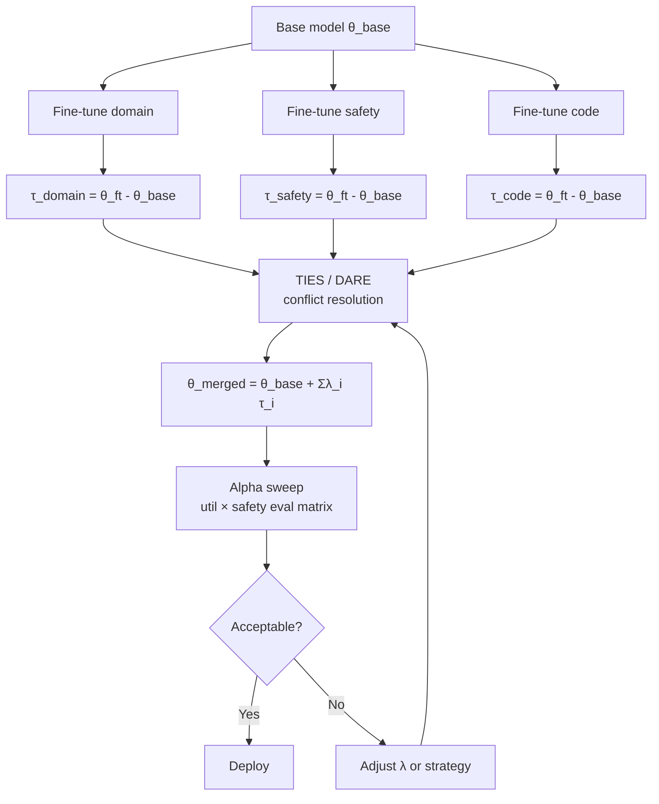

# Task Vectors & Model Merging

> **Tóm tắt:** Task vectors xem fine-tuning như một phép toán trong weight space. Bằng cách trừ base model khỏi fine-tuned model, ta thu được một *delta* mang theo toàn bộ skill — có thể scale, cộng, trừ, hoặc kết hợp với delta khác mà không cần train lại. Nhưng delta đồng thời mang theo cả capability lẫn safety regression: merge không cẩn thận có thể tạo ra model đa năng nhưng nguy hiểm hơn.

---

## Plain English

Khi bạn fine-tune một model, thực chất bạn đang *dịch chuyển* một điểm trong không gian hàng tỷ chiều — từ vị trí base đến vị trí mới mang skill cụ thể. Task vector chính là vector dịch chuyển đó: $\tau = \theta_{\text{fine-tuned}} - \theta_{\text{base}}$.

Điều thú vị: bạn có thể *cộng nhiều vector* vào base model cùng lúc. Muốn model vừa giỏi code vừa giỏi math? Lấy $\tau_{\text{code}}$ và $\tau_{\text{math}}$, nhân với hệ số $\lambda$, rồi cộng vào base. Không cần dữ liệu, không cần GPU hours để retrain từ đầu.

Thực tế phức tạp hơn: các delta thường *xung đột* nhau ở các weight cụ thể — delta này muốn tăng một tham số, delta kia muốn giảm. Các phương pháp như TIES (xử lý sign conflict), DARE (drop ngẫu nhiên delta nhỏ), và SafeMERGE (ưu tiên bảo vệ safety-critical weights) ra đời để xử lý vấn đề này.

Nguy hiểm ít được nhắc đến: fine-tune domain (vd: y tế, pháp lý) có thể *silently undo* safety alignment. Merge một safety model và một domain model không đảm bảo output an toàn — phải eval explicit.

---

## Mental Model

> **Analogy:** Hãy tưởng tượng base model là một tờ giấy trắng. Mỗi fine-tune để lại một *dấu mực* khác màu lên tờ giấy đó — màu xanh là code skill, màu đỏ là safety alignment, màu vàng là domain knowledge. Model merging giống pha nhiều tờ giấy có dấu mực vào nhau. Nếu các dấu mực nằm ở chỗ khác nhau, kết quả đẹp. Nếu chúng chồng lên nhau, màu trộn lẫn và có thể ra màu bùn — hoặc tệ hơn, màu đỏ (safety) bị màu khác lấn át hoàn toàn.

**Các điểm cốt lõi cần nhớ:**

- **Task arithmetic** thao tác với weight deltas như các vector số học bình thường — cộng, trừ, nhân scalar đều hợp lệ.
- **TIES** giải quyết sign conflicts: trim delta nhỏ → vote đa số cho sign → chỉ merge params đồng sign với vote.
- **DARE** drop ngẫu nhiên $p\%$ của delta rồi rescale $1/(1-p)$ — giảm interference khi merge nhiều model.
- **SafeMERGE** tính *safety sensitivity* $S_l = \|\nabla_{W_l} \mathcal{L}_{\text{safety}}\|$ cho từng layer, ưu tiên giữ nguyên safety-critical weights.
- Fine-tune domain **không trung lập với safety**: delta domain thường chứa cả safety regression ngầm.

---

## Cơ chế (Mechanism)

### Task Vector cơ bản

$$
\tau_i = \theta_{\text{ft},i} - \theta_{\text{base}}
$$

Trong đó $\theta_{\text{ft},i}$ là weights của model fine-tuned cho task $i$, $\theta_{\text{base}}$ là base model.

### Task Arithmetic (merge nhiều tasks)

$$
\theta_{\text{new}} = \theta_{\text{base}} + \sum_{i} \lambda_i \cdot \tau_i
$$

$\lambda_i \in [0, 1]$ là scaling coefficient — điều chỉnh mức độ đóng góp của từng task. Alpha sweep là quá trình thử nhiều $\lambda$ combinations để tìm điểm tối ưu trên utility-safety tradeoff.

### TIES-Merging

Ba bước tuần tự cho mỗi parameter:

$$
\text{1. Trim: } \tau_i^{(k)} \leftarrow \tau_i^{(k)} \cdot \mathbf{1}\left[|\tau_i^{(k)}| \geq \text{quantile}_{1-\rho}(|\tau_i|)\right]
$$

$$
\text{2. Elect: } \hat{s}^{(k)} = \text{sign}\!\left(\sum_i \tau_i^{(k)}\right)
$$

$$
\text{3. Merge: } \tau_{\text{TIES}}^{(k)} = \frac{\sum_i \tau_i^{(k)} \cdot \mathbf{1}\!\left[\text{sign}(\tau_i^{(k)}) = \hat{s}^{(k)}\right]}{\left|\{i : \text{sign}(\tau_i^{(k)}) = \hat{s}^{(k)}\}\right|}
$$

Chỉ giữ $\rho$ fraction (top by magnitude) tham số khi merge — giảm noise từ small updates.

### DARE (Drop And REscale)

$$
\tilde{\tau}_i^{(k)} = \frac{\delta_i^{(k)} \cdot m_i^{(k)}}{1 - p}, \quad m_i^{(k)} \sim \text{Bernoulli}(1 - p)
$$

Drop ngẫu nhiên $p$ fraction của delta, rescale phần còn lại để giữ expectation. Mục tiêu: giảm interference khi merge nhiều model cùng lúc.

### SafeMERGE

$$
S_l = \left\|\nabla_{W_l} \mathcal{L}_{\text{safety}}\right\|_F
$$

$$
\theta_{\text{merged}, l} = \theta_{\text{base}, l} + \lambda \cdot \frac{1}{S_l + \epsilon} \cdot \tau_{\text{domain}, l}
$$

Layers có safety sensitivity cao ($S_l$ lớn) nhận ít delta domain hơn — bảo toàn alignment ở các vị trí quan trọng.

---

## Diagram



---

## How It Works — Step-by-Step

**Bước 1 — Tạo task vectors**
Với mỗi fine-tuned model, tính delta so với base: $\tau_i = \theta_{\text{ft},i} - \theta_{\text{base}}$. Lưu source checkpoints và delta riêng biệt — đây là điều kiện để rollback sau này.

**Bước 2 — Chọn merge strategy**
- *Linear sum*: đơn giản nhất, dùng khi số task ít và delta orthogonal.
- *TIES*: khi merge nhiều task, có sign conflicts rõ ràng.
- *DARE*: khi muốn merge nhiều model và lo interference.
- *SafeMERGE*: bắt buộc khi có safety model trong danh sách merge.

**Bước 3 — Alpha sweep**
Thử grid of $\lambda_i$ values (vd: $\{0.3, 0.5, 0.7, 1.0\}$ per task). Với mỗi combination, eval trên utility benchmark + safety eval. Plot Pareto frontier utility vs safety.

**Bước 4 — Eval matrix**
Chạy eval trên: (a) base model, (b) từng source fine-tuned model, (c) từng candidate merge. Không chỉ nhìn vào average — breakdown theo task, domain, language.

**Bước 5 — Chọn merge config**
Chọn config tối thiểu hóa interference (không có task nào bị drop quá $5\%$ so với individual), tối đa hóa utility tổng, và duy trì safety refusal $\geq$ baseline.

**Bước 6 — Lưu artifacts và rollback plan**
Lưu: source checkpoints (pinned), merge config file (lambdas + strategy), alpha sweep report, safety retain eval. Rollback = deploy lại source checkpoint tương ứng.

---

## Code

```python
import torch
from transformers import AutoModelForCausalLM


def compute_task_vector(
    finetuned_path: str,
    base_path: str,
    dtype=torch.float32,
) -> dict[str, torch.Tensor]:
    """Tính task vector = fine-tuned weights - base weights."""
    base = AutoModelForCausalLM.from_pretrained(base_path, torch_dtype=dtype)
    finetuned = AutoModelForCausalLM.from_pretrained(finetuned_path, torch_dtype=dtype)

    base_params = dict(base.named_parameters())
    task_vector = {
        name: param.data - base_params[name].data
        for name, param in finetuned.named_parameters()
        if name in base_params
    }
    return task_vector


def apply_task_arithmetic(
    base_path: str,
    task_vectors: list[dict[str, torch.Tensor]],
    lambdas: list[float],
    output_path: str,
    dtype=torch.float32,
) -> AutoModelForCausalLM:
    """Áp dụng task arithmetic: θ_new = θ_base + Σ λ_i · τ_i."""
    assert len(task_vectors) == len(lambdas), "Số task vectors và lambdas phải bằng nhau"
    model = AutoModelForCausalLM.from_pretrained(base_path, torch_dtype=dtype)

    for name, param in model.named_parameters():
        delta = sum(
            lam * tv[name]
            for lam, tv in zip(lambdas, task_vectors)
            if name in tv
        )
        param.data += delta

    model.save_pretrained(output_path)
    return model


def ties_merge(
    task_vectors: list[dict[str, torch.Tensor]],
    density: float = 0.2,
) -> dict[str, torch.Tensor]:
    """
    TIES-Merging: Trim → Elect → Merge.
    density: fraction of parameters to keep (top by magnitude).
    """
    merged = {}
    all_keys = set().union(*[tv.keys() for tv in task_vectors])

    for name in all_keys:
        tensors = [tv[name] for tv in task_vectors if name in tv]
        stacked = torch.stack(tensors)  # shape: [n_models, ...]

        # Step 1: Trim — giữ top density% by magnitude
        flat = stacked.abs().view(stacked.shape[0], -1)
        threshold = flat.quantile(1 - density, dim=1, keepdim=True)
        threshold = threshold.view(stacked.shape[0], *([1] * (stacked.dim() - 1)))
        trimmed = stacked * (stacked.abs() >= threshold).float()

        # Step 2: Elect — majority sign vote
        sign_sum = trimmed.sign().sum(dim=0)
        elected_sign = sign_sum.sign()
        # Tie-break: default positive
        elected_sign[elected_sign == 0] = 1

        # Step 3: Merge — mean of params với sign đồng thuận
        same_sign_mask = (trimmed.sign() == elected_sign.unsqueeze(0)).float()
        same_sign_vals = trimmed * same_sign_mask
        count = same_sign_mask.sum(dim=0).clamp(min=1)
        merged[name] = same_sign_vals.sum(dim=0) / count

    return merged


def dare_merge(
    task_vectors: list[dict[str, torch.Tensor]],
    drop_rate: float = 0.9,
    seed: int = 42,
) -> dict[str, torch.Tensor]:
    """
    DARE: Drop And REscale.
    drop_rate: fraction của delta bị zeroed out.
    """
    torch.manual_seed(seed)
    merged = {}
    all_keys = set().union(*[tv.keys() for tv in task_vectors])

    for name in all_keys:
        tensors = [tv[name] for tv in task_vectors if name in tv]
        stacked = torch.stack(tensors)

        # Randomly drop drop_rate fraction, rescale remaining
        keep_prob = 1.0 - drop_rate
        mask = torch.bernoulli(torch.full_like(stacked, keep_prob))
        rescaled = stacked * mask / keep_prob  # unbiased estimator
        merged[name] = rescaled.mean(dim=0)

    return merged


def alpha_sweep(
    base_path: str,
    task_vectors: list[dict[str, torch.Tensor]],
    eval_fn,  # callable(model) -> dict[str, float] với keys "utility", "safety"
    lambda_grid: list[float] | None = None,
    output_dir: str = "./sweep_results",
) -> list[dict]:
    """
    Grid search trên lambda values, trả về bảng kết quả.
    eval_fn nhận AutoModelForCausalLM, trả về {"utility": float, "safety": float}.
    """
    import itertools, os, json

    if lambda_grid is None:
        lambda_grid = [0.3, 0.5, 0.7, 1.0]

    os.makedirs(output_dir, exist_ok=True)
    results = []

    combos = list(itertools.product(lambda_grid, repeat=len(task_vectors)))
    for combo in combos:
        lambdas = list(combo)
        tmp_path = os.path.join(output_dir, f"tmp_{'_'.join(str(l) for l in lambdas)}")
        model = apply_task_arithmetic(base_path, task_vectors, lambdas, tmp_path)
        scores = eval_fn(model)
        entry = {"lambdas": lambdas, **scores}
        results.append(entry)
        print(f"lambdas={lambdas} -> {scores}")

    with open(os.path.join(output_dir, "sweep_results.json"), "w") as f:
        json.dump(results, f, indent=2)

    return results
```

---

## Benchmarks

### Task Arithmetic — Ilharco et al. (2023)

| Setting | Avg Accuracy | Notes |
|---|---|---|
| Individual fine-tuned (8 tasks) | 76.2% | Upper bound |
| Multi-task trained | 73.9% | Requires joint training |
| Task Arithmetic merge | 73.1% | No training, weight arithmetic only |
| Negation (harmful task vector) | −35% toxic outputs | Remove unwanted behavior |

### TIES-Merging — Yadav et al. (2023)

| Setting | Avg Accuracy (8 tasks) | vs Task Arithmetic |
|---|---|---|
| Task Arithmetic | 73.1% | baseline |
| TIES (density=0.2) | 77.3% | +4.2% |
| TIES (density=0.5) | 75.8% | +2.7% |

Sign conflict resolution là yếu tố quan trọng nhất khi merge số lượng lớn task.

### DARE — Yu et al. (2024)

| Drop Rate | Accuracy Loss | Interference Reduction |
|---|---|---|
| p = 0.5 | −5% | Moderate |
| p = 0.9 | −10–20% | High |
| p = 0.95 | −25%+ | Very high |

Drop 90% delta → chỉ mất 10–20% accuracy, nhưng cho phép merge nhiều fine-tuned models sạch hơn đáng kể.

### SafeMERGE — IBM Research (2024)

| Merge Method | Safety Refusal Rate | Domain Utility |
|---|---|---|
| Base model only | 95% | Low |
| Domain fine-tune only | 61% | High |
| Naive merge (λ=0.5) | 71% | Medium |
| SafeMERGE | 91% | Medium-High |

---

## Khi Nào Dùng / Khi Nào Không

> [!success] Dùng khi
> - Cần kết hợp nhiều domain adapters / fine-tuned models **mà không muốn train lại** từ đầu.
> - Fine-tune domain làm yếu safety và cần merge với safety-retained model.
> - Muốn **sweep nhanh nhiều tỷ lệ mix** để tìm điểm trade-off utility–safety.
> - Có source checkpoints được lưu đầy đủ và muốn rollback linh hoạt.
> - Cần combine skills từ nhiều vendors / community fine-tunes trên cùng base.

> [!danger] Không dùng khi
> - Source models **không cùng base architecture, tokenizer, hoặc vocab** — delta không tương thích.
> - **Không biết** delta nào trong fine-tune mang unsafe behavior — merge mù là gamble.
> - **Không có source checkpoints** — mất khả năng rollback và audit.
> - Cần performance cực cao trên một task duy nhất — individual fine-tune vẫn tốt hơn.
> - Domain data có thể chứa adversarial fine-tuning (model đã bị intentionally misaligned).

---

## Failure Modes

| Failure Mode | Nguyên nhân | Mitigation |
|---|---|---|
| **Interference** — hai skills triệt tiêu nhau | Overlapping weight updates với signs ngược chiều | TIES conflict resolution; giảm số task trong một merge |
| **Safety drift** — merge kéo unsafe compliance lên | Domain delta chứa safety regression ngầm | SafeMERGE + explicit safety retain eval trước và sau merge |
| **Cherry-pick benchmark** — average che lỗi category | Một số tasks bị drop mạnh nhưng average vẫn ổn | Breakdown by task / domain / language; per-category floor |
| **Merge destructive** — không thể phục hồi | Không giữ source checkpoints và merge config | Always save: source checkpoints + lambdas + strategy + eval scores |
| **Overfit alpha** — lambda được chọn overfit eval set | Sweep quá nhiều trên cùng eval set | Hold-out eval set; ít nhất 2 eval sets (sweep + final test) |
| **Architecture mismatch** — silent wrong behavior | Merge models có cùng tên layer nhưng khác semantics | Verify same base model hash trước khi merge |

---

## Evals

| Loại | Test | Tín hiệu lỗi |
|---|---|---|
| **Baseline matrix** | Eval base + từng source model + từng candidate merge trên cùng benchmark | Nếu không có baseline, không biết lỗi từ merge hay từ source |
| **Alpha sweep** | Grid search nhiều $\lambda$ combinations, plot utility vs safety curve | Chọn điểm không nằm trên Pareto frontier = lãng phí |
| **Safety retain** | Harmful request compliance rate, benign acceptance rate, jailbreak resistance | Utility tăng nhưng safety refusal tụt > 5% = reject merge |
| **Interference map** | Per-task accuracy: base → source → merge, so sánh từng task | Average tốt nhưng một task bị drop mạnh = hidden failure |
| **Side-effect audit** | Tasks không liên quan đến merge (unrelated domains) | Merge làm hỏng general capability ngoài scope |
| **Rollback test** | Có thể load lại source checkpoint và reproduce source eval không? | Artifacts không đủ → không thể audit sau khi deploy |

---

## Artifacts

Phải lưu đầy đủ trước khi deploy:

- **Source checkpoints** (pinned, immutable) — tất cả fine-tuned models tham gia merge
- **Merge config** — strategy (TIES/DARE/SafeMERGE), lambdas, density params
- **Alpha sweep report** — bảng kết quả tất cả lambda combinations đã thử
- **Safety retain eval** — trước và sau merge, per-category breakdown
- **Rollback plan** — quy trình và SLA để revert về source checkpoint nếu production issue

---

## References

- Ilharco et al. (2023). *Editing Models with Task Arithmetic*. ICLR 2023. [arXiv:2212.04089](https://arxiv.org/abs/2212.04089)
- Yadav et al. (2023). *TIES-Merging: Resolving Interference When Merging Models*. [arXiv:2306.01708](https://arxiv.org/abs/2306.01708)
- Yu et al. (2024). *Language Models are Super Mario: Absorbing Abilities from Homologous Models as a Free Lunch (DARE)*. [arXiv:2311.03099](https://arxiv.org/abs/2311.03099)
- SafeMERGE. IBM Research, 2024.
- [[Knowledge Editing - ROME & MEMIT]] — causal tracing approach, contrast với weight-space arithmetic
- [[LoRA & PEFT]] — delta cũng là một loại task vector khi LoRA adapter được merged vào base
- [[Activation Steering]] — can thiệp representation thay vì weight space
- [[LLM Model Editing - MOC]] — map toàn bộ các kỹ thuật
